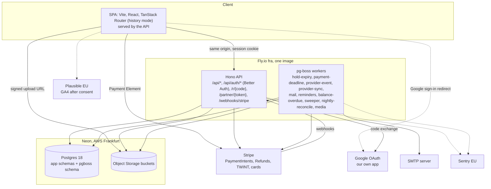
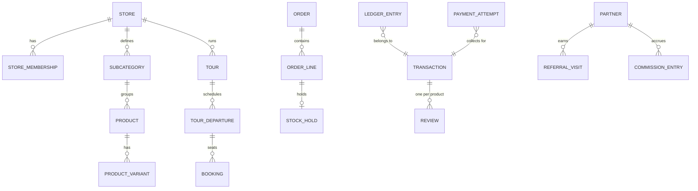
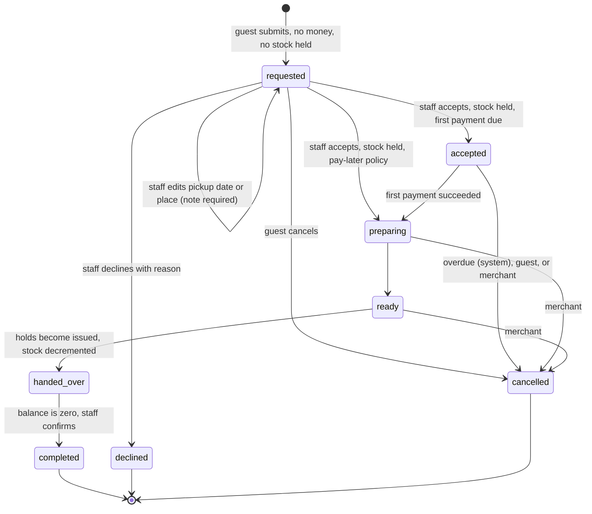
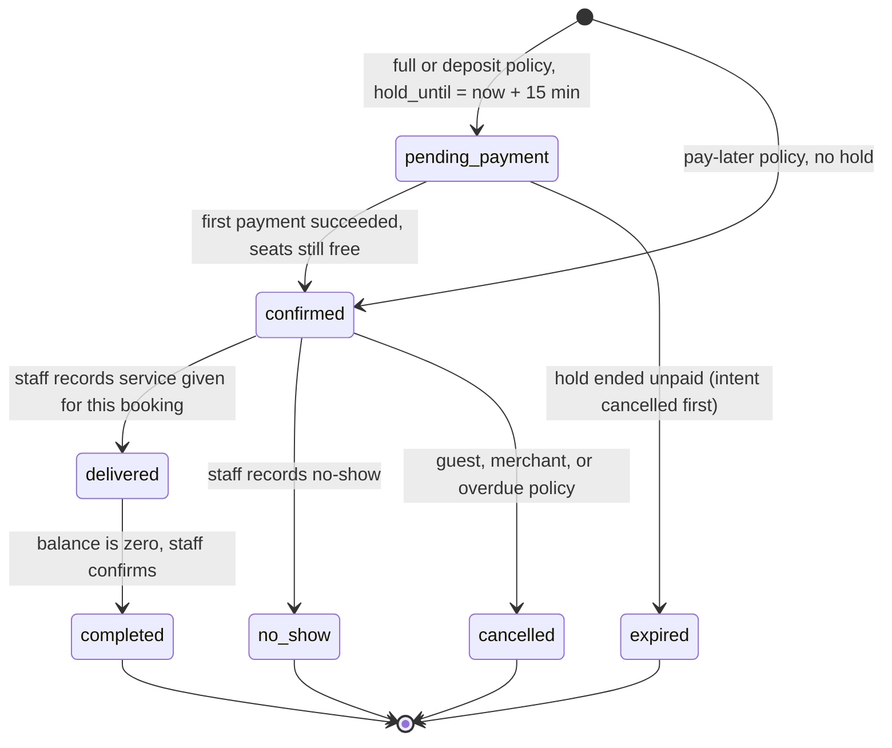

# Swiss Keepsakes backend architecture

Status: proposal for owner review. Last updated 20.10.2026.

This document describes the production backend for Swiss Keepsakes. It replaces the browser-held mock data in `front-end/`. Product rules come from `docs/PRD/Swiss_Stories_and_Gifts_PRD_v2.md` (cited as PRD Lnnn), `docs/ux/ux-spec-phase1.md` (cited as UX Lnnn), and the prototype types in `front-end/src/features/*/types.ts`. Vendor facts are numbered F1 to F29 in section 18.

## 1. Summary

The backend is one TypeScript service. It runs the HTTP API and the background jobs, and it is deployed on Fly.io in Frankfurt. Postgres and file storage run on Neon in AWS Frankfurt. Stripe takes payments by card and TWINT.

| Layer | Choice |
|---|---|
| Front-end | The existing React 19 and Vite SPA, served by the API from the same origin |
| API and jobs | Hono on Node (`@hono/node-server`), one codebase that runs as API, worker, or both |
| Jobs and timers | pg-boss, with its queue in the application database |
| Database | Neon Postgres 18, AWS Frankfurt |
| File storage | Neon Object Storage, AWS Frankfurt, through its S3-compatible API |
| ORM and migrations | Drizzle |
| Auth | Better Auth inside the API at `/api/auth/*`, with Google sign-in and an emailed 6-digit code. The session is an HttpOnly cookie on our own origin. |
| API contract | `@hono/zod-openapi`, with a generated client for the front-end |
| Data fetching and mutations | TanStack Query in the SPA, calling the generated client |
| Markdown rendering | Streamdown |
| Hosting | Fly.io, region `fra` |
| Payments | Stripe Payment Element with PaymentIntents, cards, TWINT, Apple Pay and Google Pay |
| Email | SMTP through one `Mailer` port. The server and credentials come from environment variables |
| Errors and analytics | Sentry EU, Plausible EU, and Google Analytics 4 after cookie consent |
| Repository | Monorepo with `front-end/`, `api/`, `packages/domain`, `packages/api-contract` and `packages/i18n` |

Five choices carry the design:

1. A long-running service owns every timer. The 15-minute seat hold and the first-payment deadline call Stripe when they fire, so they need a process that stays up. Request-driven functions don't fit this work (F1).
2. Postgres row locks decide every seat and every unit of stock. Nothing else holds a lock.
3. Money history is append-only. Balances and payment labels are computed from ledger rows and never stored.
4. Each store has its own Stripe account from the start. Phase 1 uses the pilot merchant's own account. Stripe Connect is added when a second merchant joins or the platform fee starts, and the code is already shaped for it.
5. Each business area is a module with its own Postgres schema and its own pure rules, inside one deployable.

## 2. Decisions

| # | Decision | Rejected alternatives | Revisit when |
|---|---|---|---|
| D1 | One TypeScript service (Node LTS) with Hono on `@hono/node-server`. It runs the HTTP API and the pg-boss workers. `ROLE=api`, `worker` or `all` selects what a process runs. Production starts with two machines in `all`. | Neon Functions: each function runs per request, idle functions can be evicted, and Neon says they aren't a job queue (F1). Fastify: equally capable, but Hono has first-party `@hono/zod-openapi` and exposes the raw body that Stripe signature checks need (F21). NestJS: more structure than one small team needs. | Load needs the API and the workers to scale apart. Set `ROLE` per machine. |
| D2 | Neon Postgres 18 in AWS Frankfurt (`aws-eu-central-1`), used as managed Postgres only. The Neon project `plain-resonance-94662542` has three long-lived branches, `production` (default), `staging` and `development`. `api/neon.ts` declares the services, and `neon env pull` writes each branch's variables to `api/.env.local` (development), `api/.env.staging.local` and `api/.env.production.local`, all gitignored. Launch plan. Production compute is fixed at 0.5 CU or more with scale to zero off, because pg-boss polls all the time and a cold start would delay holds. pg-boss and migrations use the direct connection string. Request handlers use the pooled one. Restore history of 7 days or more is on before the first live charge. Neon Functions, triggers and the Data API stay off. Neon Auth is still provisioned on the three branches (`auth: true` in `api/neon.ts`), but nothing uses it since D8 changed on 20.10.2026. The owner decides later whether to switch it off. | Supabase Zurich: keeps data at rest in Switzerland, but point-in-time recovery is an add-on of about USD 100 a month (F5), and its auth and API layers would go unused. Self-managed Postgres on Hetzner: backups and failover become our job. | The data-protection review requires data at rest in Switzerland. Move to Supabase Zurich. Only the connection strings change. |
| D3 | Fly.io `fra`, one image. The API serves the built SPA with an index fallback, so the SPA and the API share one origin and the SPA can use history routing. | Render Frankfurt: equivalent. Fly gives machine-level control. Exoscale: Swiss compute, more to operate. A separate static host for the SPA: a second origin, tokens in JavaScript, and CORS. | The review requires compute in Switzerland as well. Move to Exoscale. |
| D4 | pg-boss in the application database for every timer and side effect. Jobs are created inside the business transaction (`boss.send(..., { db: tx })`, F14). There is no separate outbox table and no event bus. Cross-module work that must be atomic, such as commission on completion, runs as direct calls in the same transaction. Only outside effects become jobs. | BullMQ with Redis: a second stateful service. Inngest or QStash: a vendor for work Postgres already does. An outbox table with an event bus: two mechanisms where one is enough. | Thousands of jobs per second, or Redis arrives for another reason. |
| D5 | Append-only ledger. One SQL view and one pure function compute balances and payment labels. | Stored `paid_status` fields drift under duplicates and corrections. Event sourcing adds nothing the ledger and audit log don't already give. | None expected. |
| D6 | Stripe per store, Connect deferred. `stores.stripe_account_id` is nullable. In Phase 1 the API holds a restricted key for the pilot store's own account, and Stripe calls carry `stripeAccount` only when the column is set. | Connect from day one: it needs a platform account owned by an entity in a Stripe country, and Vietnam isn't one (F6). That blocks launch for no Phase 1 gain. Destination charges: the platform becomes the business of record on the charge, against PRD L326. Platform as merchant of record: legal exposure. | A second merchant onboards, or the platform fee (O17) starts. Both need the platform account. See section 7.4. |
| D7 | Payment Element with PaymentIntents. Cards and TWINT come from the account's Dashboard settings. Apple Pay and Google Pay come through the Element. A deposit and its balance are two PaymentIntents. The server confirms every payment itself with a Stripe ConfirmationToken (F23), so it can refuse a payment for a hold that has ended. Cards use manual capture, so card money moves only while the hold is valid. TWINT doesn't support manual capture (F9). Section 6.4 has the full rule. | Checkout Session: its shortest expiry is 30 minutes (F12), longer than the 15-minute hold, and its PaymentIntent can't be cancelled directly except in `requires_capture` (F11). | The hold grows to 30 minutes or more and the owner prefers Stripe's hosted page. |
| D8 | Better Auth inside our Hono API, decided by the owner on 20.10.2026. It is mounted at `/api/auth/*` and keeps its tables in our Postgres through the Drizzle adapter, in the `identity` schema. Every database branch therefore carries its own users. Guests and staff sign in with Google, through our own Google OAuth app, or with an emailed 6-digit code (UX L327, L328). Only the `emailOTP` plugin and the Google provider are on. Email and password, magic link, device flow, SSO and the OAuth proxy stay off. The session is an HttpOnly cookie that our own origin sets (D3), so it is first-party. It is `Secure` on staging and production and `SameSite=Lax`. No token reaches browser JavaScript. There is no JWT, no JWKS and no Bearer header. The API's auth middleware calls `auth.api.getSession({ headers })` and builds the actor from the session (section 9). The SPA uses Better Auth's own client from the same pinned package, loaded lazily. Roles live in our own `store_memberships`, and Super Admin is a row in `identity.platform_admins`, not Better Auth's admin plugin. Partners have no user rows. They get their own token, code and session (UX L236, R10). `better-auth` is pinned at 1.7.7 or later (F27, R13). Section 9 lists the settings. Their option names were checked against the Better Auth docs on 20.10.2026 (F25, F26), and E2.2 checked each one against the installed 1.7.11 (F30). Superseded. On 19.10.2026 D8 chose Neon Auth, Neon's managed Better Auth, and the owner dropped it on 20.10.2026. Its session cookie comes from Neon's domain, so it is third-party on our origin, and Playwright WebKit refused it in the E2.1 run (F28). | Neon Auth: its session cookie is third-party on our origin, and WebKit refuses it with or without `Partitioned` (PR #19). Neon's docs name only a reverse proxy or a shared parent domain as workarounds. Neon's own proxy toolkit is beta and has an open cookie-renewal bug (F28). Supabase Auth: a second vendor. Clerk or Auth0: US data and per-user billing. | A Better Auth advisory has no fixed release we can move to, or the owner wants a hosted provider again. Any hosted provider must set its cookie on our own origin. |
| D9 | Every tenant row has `store_id`. Child rows use composite foreign keys `(store_id, parent_id)`, so a child can't point at another store's parent. Every repository function requires a `StoreScope` argument. The one exception is the `notifications.sent_mail` repository (E2.8). The mail job runs without an actor and finds its row by the mail id. A read by store takes a `StoreScope`. Row-level security comes with the second merchant. | Row-level security from day one: policies on every table and `SET LOCAL` on every request, for one store. Scoping in application code without composite keys: one missed filter leaks data. | A second merchant onboards. Add policies and `SET LOCAL app.store_ids`. The schema already has the columns they need. |
| D10 | One `audit_log` for every money and status change, with before, after, actor, reason and request id. Order and booking timelines are a view over it. | A separate timeline table next to the audit log: two sources for one history. The prototype's `Order.log` and `BookingRecord.activity` arrays become audit rows. | None expected. |
| D11 | REST with `@hono/zod-openapi`. The generated client is committed under `packages/api-contract/generated/`, and CI fails if it differs from a fresh build. Errors follow RFC 9457 problem details with stable `type` codes. Lists use cursor pagination. Merchant edits send `If-Match`. Every state-changing request carries an `Idempotency-Key`, stored with a request hash and replayed for 24 hours. A reused key with a different body returns 422. Better Auth's `/api/auth/*` (D8) is the one mount outside this contract. It keeps its own routes and error codes and takes no `Idempotency-Key`. | tRPC: webhooks, redirects and partner links stay REST anyway. GraphQL: one client doesn't need it. | A second client wants typed RPC. |
| D12 | SMTP, decided by the owner on 20.10.2026. One `Mailer` port with one SMTP adapter. `SMTP_HOST`, `SMTP_PORT`, `SMTP_SECURE`, `SMTP_USER`, `SMTP_PASSWORD` and `SMTP_FROM` come from the environment. Local and staging use a test SMTP account. The production SMTP provider is open (Q15). All 24 templates (UX L474 to L497) are rendered on the server in the language stored on the transaction. N01 and N24 have no transaction and use the language the SPA sends (section 9). | Resend, the earlier choice: HTTP API, but it holds account and mail metadata in the US (F17). Amazon SES in Frankfurt: full EU residency, and it also speaks SMTP. | The data-protection review rejects the provider's data location. Point the same adapter at another SMTP server, or add an HTTP adapter behind the port. |
| D13 | Sentry EU (F18) for errors. Plausible EU (F19) for cookie-free behaviour analytics on every visit. Google Analytics 4 for marketing, loaded only after the visitor accepts cookies in a consent banner, with no personal data, engraving or chat text sent (PRD L473). Every money, status, source and traveller-group figure is SQL over our own tables (PRD L471). | GA4 alone: it sees only visitors who consent. Self-hosted Umami or Matomo: more to run. | The data-protection review rejects GA4. Drop it and keep Plausible. |
| D14 | Neon Object Storage in the same Neon project, through its S3-compatible API. A private bucket takes uploads through signed URLs that the API issues after an authorization check. A public bucket serves published media. The worker makes resized variants with `sharp` when an upload completes. | Cloudflare R2 or S3: a second vendor for a few gigabytes. | Neon Object Storage can't issue the signed URLs spike SP5 needs. Switch to Cloudflare R2 with the same S3 client. |
| D15 | The Phase 1 planner makes no model call. PRD R19 (PRD L402) says the Phase 1 assistant asks the store's fixed, ordered questions, gives no free answers and makes no plan. The scripted chat stays in the browser. One endpoint stores the request with the question set and language as asked (AC18) and queues mail N16. | A model-backed planner route now: against R19 and PRD L95. | O19 is approved. Then add a route on the AI SDK with read-only catalogue tools, a server-side key, a per-user rate limit and a spend cap. |
| D16 | Monorepo: `front-end/`, `api/`, `packages/domain` (types and pure rules), `packages/api-contract` (Zod schemas and the generated client), `packages/i18n`. | Separate repositories: the shared packages would need publishing. | None expected. |
| D17 | The schema has the four fixed categories `keepsakes`, `tours`, `stays` and `experiences` (PRD L185). Sub-categories are per store. Only `keepsakes` has sub-categories, and only `keepsakes` and `tours` are sellable in Phase 1. | Two categories, as in the prototype's `CategoryId`: needs a migration when Stays or Experiences open. | None expected. |
| D18 | No commerce engine. | Medusa, Vendure, Saleor and Shopify assume pay first, then fulfil. This product is request, accept, hold, pay later, with a commission ledger. | Standard goods with instant payment and no merchant acceptance. |
| D19 | TanStack Query owns server state in the SPA. Each feature's hooks wrap the generated client in `useQuery` and `useMutation`, so caching, retries, refetch on focus and invalidation after a mutation are handled in one place. Merchant screens poll with `refetchInterval` (section 8). The `DataClient` interface from migration phase 1 sits under the query functions, so demo mode and the API share the same hooks. | Hand-written `useEffect` fetching: loading, error and cache state repeated per screen. SWR: smaller, with weaker mutation and invalidation support. | None expected. |
| D20 | Streamdown renders Markdown in the SPA, wherever text arrives as Markdown, such as the planner assistant's messages and any model output once O19 is approved. It handles Markdown that is still streaming and incomplete. Articles keep their own section renderer, because the M17 editor stores structured sections, not Markdown. | `react-markdown`: renders incomplete Markdown from a stream badly, such as a half-open code block or table. | None expected. |

## 3. System overview



The service handles four kinds of work.

- **Reads.** `GET /api/...` reads the session cookie if there is one, parses the query and calls the module's read function. Public catalogue reads send cache headers.
- **Commands.** `POST /api/...` carries an `Idempotency-Key`. The HTTP layer checks `Origin` (section 9), loads the actor and their store memberships and parses the body. The module then runs one database transaction that writes the business change, the audit row and any pg-boss jobs. Slow work such as mail never runs inside the request.
- **Webhooks.** `POST /webhooks/stripe` verifies the signature on the raw body. It inserts `(provider, event_id)` into `webhook_events`, and a duplicate ends the request with 200. In the same transaction it queues a `provider-event` job, then returns 200. The worker applies the event.
- **Timers.** Each deadline gets a pg-boss job deferred to that exact time. A `sweeper` job runs every minute and catches any deadline whose job didn't run.

## 4. Modules

Each module owns one Postgres schema and exposes commands and queries. No module reads another module's tables, and each command is one transaction. The `reporting` module is the one exception. It owns SQL views over other schemas, so the coupling shows up in migrations.

| Module | Schema | Owns |
|---|---|---|
| identity | `identity` | `stores`, `store_memberships`, `store_invitations`, `merchant_invitations`, `platform_admins`, guest profiles, and Better Auth's tables `user`, `session`, `account`, `verification` and its rate-limit table (D8). `auth generate --adapter drizzle` writes the Drizzle definitions of Better Auth's tables, and drizzle-kit migrates them with ours. That generated schema is the source for their names and columns. The `neon_auth` schema is not used. |
| catalog | `catalog` | `subcategories`, `products`, `product_variants`, `pickup_places`, `product_pickup_places`, `tours`, `tour_departures`, `media`, `reviews` |
| orders | `orders` | `orders`, `order_lines`, `stock_holds`, pickup changes |
| bookings | `bookings` | `bookings` (with `hold_until`), participant answers |
| money | `money` | `payment_attempts`, `ledger_entries`, `money_exceptions`, `cost_records`, the `PaymentGateway` port and its Stripe adapter. Orders and bookings take payments through use cases in `money/index.ts`. |
| partners | `partners` | `partners`, `referral_visits`, `partner_sessions`, `partner_otps`, `commission_entries` |
| content | `content` | `articles` (one row per language version), `article_comments` |
| requests | `requests` | `advice_question_sets`, `advice_requests`, `private_tour_requests` |
| notifications | `notifications` | Templates in EN and DE, `sent_mail` |
| reporting | `reporting` | Views and materialized views for the M21 and M02 figures |
| Shared infrastructure, not a module | `platform` | `webhook_events`, `idempotency_keys`, `audit_log`, rate-limit windows |

The `platform` schema has no business module. Its tables belong to the shared infrastructure in `api/src/platform/` (section 4.3).

### 4.1 Layers and the dependency rule

The code follows clean architecture in four layers. Each layer may import only from the layers inside it.

| Layer | Where | Contains | May import |
|---|---|---|---|
| Domain | `packages/domain/src/<module>/` | Entities, value objects, transition tables, pure policies such as seat availability, `moneyState` and commission math | Only `packages/domain` |
| Application | `api/src/modules/<module>/application/` | One file per use case, either a command or a query. The module's `ports.ts`, beside its `index.ts`, declares the interfaces the use cases need and imports only the domain. | Domain, its own ports, and other modules' `index.ts` |
| Adapters | `api/src/modules/<module>/adapters/` | Driving adapters (HTTP routes, job handlers) that call use cases. Driven adapters (Drizzle repositories, the Stripe gateway) that implement the ports. | Application, domain, `api/src/platform/`, `packages/api-contract` |
| Platform and composition | `api/src/platform/`, `api/src/main.ts` | Database pool and transactions, pg-boss, the Hono app and middleware, the Stripe, SMTP and storage clients, config, logger, clock. `main.ts` is the only file that connects concrete adapters to use cases. | Everything |

These rules keep the layers honest without adding framework weight:

- **A use case is a plain async function.** A factory takes its dependencies, as in `makeCreateHold({ uow, bookings, jobs, payments, clock })`. There are no classes and no dependency-injection container. `main.ts` calls the factories.
- **Transactions are a port.** A use case calls `uow.run(async (tx) => ...)`, and the repositories and the job queue take that `tx`. The business write, the audit row and the pg-boss jobs therefore commit together, and the use case never touches Drizzle.
- **Locking SQL stays in the repository.** The two locking paths, order acceptance (section 6.1) and the seat hold (section 6.3), are named repository functions such as `lockDepartureForHold`. The use case decides what to do, and the repository decides how to lock.
- **Modules talk through `index.ts` only.** Each module's `index.ts` exports the use cases and types other modules may call. For example, completing a booking calls `recordCommission(tx, ...)` from `partners/index.ts` in the same transaction. No module imports another module's `application/` or `adapters/` files.
- **The domain is shared with the front-end.** The SPA imports the same transition tables and `moneyState` to decide which buttons to show and which payment label to print, so the rules live in one place.
- **The lint config enforces the rule.** `eslint-plugin-boundaries`, the plugin the front-end's ESLint setup already uses, gets one zone per forbidden direction (`eslint.boundaries.mjs`). The domain may not import anything outside `packages/domain`. The application layer may not import adapters or platform code. No module may import another module's internals. A wrong import fails CI.

### 4.2 Repository layout

The repository becomes a pnpm workspace. The front-end already uses pnpm.

```
swiss-keepsakes/
  package.json                    pnpm workspace: front-end, api, packages/*
  front-end/                      the SPA; feature folders stay as they are
  api/
    src/
      main.ts                     composition root; starts api, worker or both by ROLE
      platform/
        config.ts                 environment schema (Zod); refuses to start on a bad value
        db/                       pool, unit of work, migration runner
        jobs/                     pg-boss setup and the JobQueue adapter
        http/                     Hono app, session to actor, Origin check, idempotency, problem details,
                                  request id, rate limit, static SPA with index fallback
        auth.ts                   Better Auth instance (D8), mounted at /api/auth/*
        audit.ts                  AuditLog adapter over platform.audit_log
        webhooks.ts               webhook_events deduplication
        stripe.ts                 Stripe client factory (stripeFor(store))
        mail.ts                   SMTP client
        storage.ts                S3 client for Neon Object Storage
        clock.ts                  Clock port and the system clock
        logger.ts
      modules/
        bookings/
          index.ts                public use cases and types
          ports.ts                BookingRepository, JobQueue, Clock
          application/
            create-hold.ts
            expire-hold.ts
            confirm-first-payment.ts
            mark-delivered.ts
            mark-no-show.ts
            complete-booking.ts
            list-store-bookings.ts
          adapters/
            routes.ts             zod-openapi routes; parse, call the use case, map the result
            jobs.ts               hold-expiry and balance-overdue handlers
            booking-repository.ts Drizzle queries, including lockDepartureForHold
            schema.ts             Drizzle tables of the bookings schema
        orders/                   same shape
        catalog/
        money/                    owns the PaymentGateway port; adapters/stripe-gateway.ts implements it
        partners/
        identity/                 adapters/schema.ts also holds Better Auth's generated tables
        content/
        requests/
        notifications/            adapters/smtp-mailer.ts implements Mailer
        reporting/                adapters/views.sql
    migrations/                   generated SQL from drizzle-kit, all schemas in one sequence
    test/
      application/                use cases against in-memory fakes of the ports
      integration/                repositories, locks and adapters against a Neon branch
  packages/
    domain/
      src/
        shared/                   Rappen, branded ids, LocalizedText, Result, zurichDate
        bookings/                 types, transitions, seat availability policy, *.test.ts
        orders/                   types, transitions, stock policy
        money/                    ledger entry types, moneyState
        partners/                 attribution window, commission and offset math
        ...                       one folder per module
    api-contract/
      src/                        Zod request and response schemas, per module
      generated/                  openapi.json and the typed client (generated, committed)
    i18n/                         EN and DE strings, problem type to copy
  e2e/                            Playwright scenarios S1 to S12
  docs/
```

The front-end keeps its feature folders. Each feature's `types.ts` and its pure rules move to `packages/domain`. Its hooks call the client from `packages/api-contract`. Its components stay where they are.

### 4.3 Where common concerns live

| Concern | Location |
|---|---|
| Business rule (a status change, a price, a deadline) | `packages/domain/src/<module>/` |
| Workflow that loads, decides and saves | `api/src/modules/<module>/application/<use-case>.ts` |
| SQL and Drizzle | `api/src/modules/<module>/adapters/*-repository.ts` and `schema.ts` |
| Request parsing and response shape | `packages/api-contract/src/` schemas, used by `adapters/routes.ts` |
| Permission check | `can()` in `packages/domain/src/identity/`, called by the use case |
| Talking to Stripe, the SMTP server or storage | A port in the owning module, an adapter in that module, a client in `api/src/platform/` |
| Audit, idempotency, webhook deduplication, rate limits | `api/src/platform/` |
| Wiring | `api/src/main.ts` only |

## 5. Data model

These conventions apply to every table:

- Money is integer Rappen in `bigint`.
- Timestamps are `timestamptz` in UTC. Business dates use Europe/Zurich, through the existing `zurichDate` in `packages/domain/src/dates/zurich.ts`.
- Localized text is `jsonb` shaped `{en?, de?}`.
- Primary keys are UUIDv7, branded per entity in TypeScript. Guest-facing references such as `SK-1042` sit in a separate unique column. Better Auth's own tables are the exception. With `generateId: 'uuid'` their ids are `uuid` columns that Postgres fills with `gen_random_uuid()` (D8, F25).
- No table of ours has a foreign key to Better Auth's `user` row. Rows a guest owns, such as orders, bookings, reviews and ledger rows, point at the guest profile's id. The profile keeps the Better Auth user id only as a plain value, which account deletion clears when it anonymises the profile. Membership and audit rows hold user ids the same way, as plain values. This is the smallest design that lets Better Auth delete its user row. E6.7 confirms it at build time.
- Every store-owned row has `store_id`, and child rows have composite foreign keys.



`TRANSACTION` is an order or a booking. Tables store it as the pair `(transaction_kind, transaction_id)`, which matches the prototype's `TransactionRef`.

The columns below carry rules.

| Table | Columns |
|---|---|
| `stores` | `slug`, `name`, `status` (`invited`, `onboarding`, `live`, `suspended`), `stripe_account_id` (nullable, D6), `stripe_charges_enabled`, `stripe_payouts_enabled`, `twint_capability`, `default_language` |
| `identity.guest_profiles` | `id` (UUIDv7, `uuidv7()` in Postgres), `auth_user_id` (nullable, unique, no foreign key). The unique key makes the first authenticated call insert one row under parallel calls (E2.2). |
| `store_memberships` | `(user_id, store_id)` unique, `role` (`owner` or `manager`), `accepted_at` |
| `store_invitations` | `email`, `role`, `token_hash` (set when the invitation mail is sent, section 8), `expires_at` (7 days, UX L520), `accepted_by` |
| `subcategories` | `category` (one of the fixed four), localized `name`, `position`. Deletion is refused while products exist, through `ON DELETE RESTRICT` (PRD L199). |
| `products` | `subcategory_id`, names, story, `payment_policy` jsonb (the prototype's `PaymentPolicy`), `cancellation_policy`, `preparation_days`, `day_mode`, `commission_rate`, engraving settings, `published_at`, `archived_at`, `row_version` |
| `product_variants` | `label`, `price`, `stock_on_hand`, `not_for_sale`. Available stock is `stock_on_hand` minus the quantity in `held` holds. |
| `tours` | The prototype's `Tour`, including `sections`, `maintenance`, `keepsake_ids`, `age_bands`, `participant_fields`, `commission_rate`, `row_version` |
| `tour_departures` | `starts_at`, `ends_at`, `capacity`, `policy`, `balance_due_at`, `overdue_policy` jsonb, `closed`, `cancelled_at` |
| `orders` | `ref`, `guest_id`, `language`, `status`, `pickup_date`, `pickup_place_id`, snapshots of `payment_policy` and `cancellation_policy`, `partner_id` (fixed at creation), `accepted_at`, `first_payment_due_at`, `balance_due_date`, `completed_at`, `completed_by`, `trip` jsonb |
| `order_lines` | Snapshots of `product_name`, `variant_label`, `unit_price`, `quantity`, `engraving` and `commission_rate`, plus `basis_components` jsonb with price, personalisation and discount (PRD L362) |
| `stock_holds` | `order_line_id` unique, `variant_id`, `quantity`, `state` (`held`, `issued` or `released`) |
| `bookings` | `ref`, `guest_id`, `language`, `departure_id`, `status`, `hold_until` (null unless `pending_payment`), counts per age band, price and policy snapshots, `first_amount`, `balance_due_at`, `overdue_policy` snapshot, `partner_id`, `commission_rate`, `participant_info`, `trip` |
| `payment_attempts` | `transaction_kind`, `transaction_id`, `purpose` (`first` or `balance`), `provider_intent_id`, `amount`, `status` (`created`, `processing`, `succeeded`, `failed`, `cancelled`), `provider_succeeded_event_at` (kept for reconciliation only), `last_synced_at`. A partial unique index allows one open attempt (`created` or `processing`) per transaction and purpose. |
| `ledger_entries` | `kind` (`collection_online`, `collection_external`, `refund_online`, `refund_external`), signed `amount`, `status` (`pending`, `succeeded`, `failed`, `voided`), `method`, `provider_ref` (unique when present), `lines` jsonb for refunds (per line, basis part and non-basis part), `recorded_by`, `reason`, `supersedes_id`, `occurred_at` |
| `money_exceptions` | `payment_attempt_id`, `kind` (`late_success`, `amount_mismatch`, `unmatched`), `amount`, `resolution` (`refund_pending`, `refunded`, `kept_by_policy`), `notes` |
| `commission_entries` | `partner_id`, `store_id`, `transaction_kind`, `transaction_id`, `line_id` (null for payouts and offsets), `kind` (`recorded`, `adjustment`, `payout`, `offset`), signed `amount`, `basis`, `rate`, `refund_entry_id`, `offsets_entry_id`, `payout_method`, `payout_reference`, `recorded_by`, `occurred_at` |
| `reviews` | `(guest_id, transaction_kind, transaction_id, product_or_tour_id)` unique. A guest can insert one only while the transaction is `completed` (AC17). |
| `referral_visits` | `partner_id`, `visitor_id` (first-party cookie), `user_id` (filled at sign-in), `at`, `landing_path`, `via_qr` |
| `partners` | `kind`, `code`, `email`, `report_token_hash`, `report_token_version`, `archived_at` |
| `platform.webhook_events` | `(provider, event_id)` primary key, `received_at`, `processed_at`, `payload` |
| `platform.idempotency_keys` | `actor_id`, `key`, `request_hash`, `response`, `expires_at` |
| `platform.audit_log` | `store_id`, `actor`, `entity`, `entity_id`, `action`, `before`, `after`, `reason`, `at`, `request_id` |

These database constraints enforce product rules directly:

- `commission_entries` is unique on `(transaction_kind, transaction_id, line_id) WHERE kind = 'recorded'`, so commission is recorded once (AC10). It is also unique on `(refund_entry_id, line_id) WHERE kind = 'adjustment'`, so each refund adjusts each line once (PRD L340).
- `ledger_entries.provider_ref` is unique, so a replayed `payment_intent.succeeded` can't record the money twice (PRD L510).
- `CHECK` constraints list the valid statuses and forbid `hold_until` outside `pending_payment`.
- The runtime database role can't run DDL. Migrations use a separate role.

## 6. State machines

Each lifecycle is a transition table in `packages/domain/src/<module>/transitions.ts`. `transition(state, command, actor)` returns the new state and its side effects, or a typed refusal. Handlers never set a status directly.

### 6.1 Keepsake order

The statuses come from the prototype's `OrderStatus`.



Acceptance holds stock for the whole order in one transaction (PRD L148, UX L70, AC05):

```sql
BEGIN;
SELECT id, status FROM orders.orders WHERE id = $order AND store_id = $store FOR UPDATE;  -- must be 'requested'
SELECT v.id, v.stock_on_hand,
       coalesce((SELECT sum(h.quantity) FROM orders.stock_holds h
                  WHERE h.variant_id = v.id AND h.state = 'held'), 0) AS held
  FROM catalog.product_variants v
 WHERE v.id = ANY($variant_ids)
 ORDER BY v.id              -- fixed order prevents deadlocks between two staff
   FOR UPDATE;
-- any line with stock_on_hand - held < quantity: ROLLBACK, return the short lines (UX L334)
INSERT INTO orders.stock_holds (...) VALUES (..., 'held');
UPDATE orders.orders SET status = CASE WHEN $first_due > 0 THEN 'accepted' ELSE 'preparing' END,
       accepted_at = now(),
       first_payment_due_at = CASE WHEN $first_due > 0 THEN now() + $first_due_hours ELSE NULL END;
INSERT INTO platform.audit_log (...);
-- pg-boss: 'mail' job (N04 or N05); 'payment-deadline' job deferred to first_payment_due_at when applicable
COMMIT;
```

The guards are:

- Cancellation, by staff or by the deadline job, sets the order's `held` holds to `released`.
- Handover sets the holds to `issued` and lowers `stock_on_hand` by the same quantity in the same statement. Issued units never count as available again.
- A refund never returns stock (PRD L148).
- `handed_over` to `completed` requires a zero balance, and the same transaction records the commission (section 7.3).
- The overdue job skips pay-later orders and deposit balances (PRD L308), and it never touches other orders from the same cart.

The refund labels `partially_refunded` and `refunded` (UX L47, L48) come from the ledger. They aren't progress statuses.

### 6.2 Tour booking

The statuses come from the prototype's `BookingStatus`.



The guards are:

- `no_show` records no commission and opens no review (PRD L342, AC09).
- When the merchant cancels a departure, its bookings become `cancelled`, never `no_show` (UX L100, S7).
- `delivered` to `completed` requires a zero balance.
- The balance-overdue job applies the booking's `overdue_policy` snapshot. `cancel` cancels the booking, releases the seats and sends N11. `grace` checks again after `graceHours`. With no policy, the job lists the booking in M02 for the merchant and changes nothing (AC27, R07).

### 6.3 Seat availability and the hold

This query counts the seats taken on a departure:

```sql
SELECT coalesce(sum(adults + children + seated_infants), 0)
  FROM bookings.bookings
 WHERE departure_id = $departure
   AND (status IN ('confirmed', 'delivered', 'completed', 'no_show')
        OR (status = 'pending_payment' AND hold_until > now()));
```

The guest's countdown, their right to pay, and the seat reservation all end at `hold_until`. Expiry releases the seats at once, as PRD L161 requires. The owner rejected a grace period after the hold (Q14). Section 6.4 describes how the payment flow keeps money from arriving after the seats are gone.

To create a hold, the API does the following in one transaction:

1. Lock the departure row with `FOR UPDATE`.
2. Refuse if the departure is closed or cancelled, or if the tour is under maintenance.
3. Count the seats taken with the query above. Refuse with `departure-sold-out` if taken plus requested exceeds capacity (UX L319).
4. Insert the booking with `status = 'pending_payment'` and `hold_until = now() + interval '15 minutes'`.
5. Write the audit row and create the `hold-expiry` job deferred to `hold_until`.

After the commit, the API creates the PaymentIntent with idempotency key `booking:{id}:first`, stores the attempt and returns the client secret. If Stripe is down, the booking still exists with its hold, and the guest sees a retry button. A page reload reads the same `hold_until`, so it can't extend the hold. A pay-later booking takes the same lock and the same capacity check, then goes straight to `confirmed` with `hold_until` null.

### 6.4 Late provider results

This rule follows UX L104 and PRD L161. The design first stops money from arriving after a hold ends. It then handles the few seconds of risk that remain.

**Prevention.**

1. **The server confirms every payment.** The Payment Element creates a ConfirmationToken in the browser and sends it to `POST /api/me/payment-attempts/{id}/confirm` (F23). The API locks the booking and refuses to confirm unless the booking is `pending_payment` and at least 60 seconds of the hold remain. The guest sees "Time is almost up" and can start a new booking. Only then does the API confirm the PaymentIntent with Stripe.
2. **Expiry cancels the payment on time.** The `hold-expiry` job is deferred to `hold_until` and cancels the PaymentIntent first. A TWINT payment still waiting for approval in the app can be cancelled, so an approval after that point fails.
3. **Cards are authorized, then captured.** Card PaymentIntents use `capture_method=manual`. When the authorization arrives, the success check below captures it only if the hold is still valid. Otherwise it cancels the authorization, and no money moves. TWINT doesn't support manual capture (F9), so steps 1 and 2 cover it.

What remains is a race of a few seconds, when a TWINT approval lands just as the expiry job cancels. The owner decided that the system refunds that money automatically (Q3).

**The rule.** It applies wherever the service observes a successful payment or a card authorization, whether in the webhook worker, the expiry job or the provider sync.

1. **Only `pending_payment` can confirm.** An `expired` or `cancelled` booking never moves back. A payment for one of those writes a `money_exceptions` row of kind `late_success`, queues a `refund` job that runs automatically, and sends N22 to the guest and the store. A card authorization for one of those is cancelled instead, so no refund is needed.
2. **Expiry cancels the payment before it expires the booking.** The `hold-expiry` job locks the booking row and exits if the status isn't `pending_payment`. Otherwise it cancels the PaymentIntent first.
   - If the cancel succeeds, or the intent was already cancelled, the booking becomes `expired` with `hold_until` null. The job writes the audit row and sends the mail. A card authorization is released with the cancel.
   - If Stripe refuses because the payment already succeeded (F11), the job runs the success check in step 3.
   - If Stripe refuses because the intent is `processing`, the booking stays `pending_payment`, but its seats already stopped counting at `hold_until`. This case is rare for TWINT and cards (F9). The webhook or the nightly reconcile settles it later through step 3.
3. **The success check runs under the departure lock.** In one transaction the service locks the departure and the booking and requires `pending_payment`. It counts the seats taken, excluding this booking. If the hold hasn't ended, the seats are still counted for this booking, so it fits. If it has ended, the booking fits only if the seats are still free.
   - If the booking fits and the payment is a card authorization, the service captures it while holding the lock. If the capture fails, the transaction rolls back and the booking stays `pending_payment` until expiry cancels it.
   - If the booking fits, it becomes `confirmed`. The service records the payment, writes the audit row and sends N09.
   - If the booking doesn't fit, it becomes `expired` and follows step 1.

The rule needs no Stripe timestamp. The decision rests on the PaymentIntent's state and on the seat count at confirm time. `provider_succeeded_event_at` is stored for the reconciliation report only.

Keepsake orders follow the same pattern against `first_payment_due_at`. The `payment-deadline` job locks the order, exits unless it is `accepted`, and cancels the open PaymentIntent first. If Stripe refuses because the payment succeeded, the order moves to `preparing`. Its stock holds are still `held`, so it needs no stock check. Otherwise the order becomes `cancelled` with reason `overdue`, its holds are released, and the job sends N23 (PRD L308).

## 7. Money

### 7.1 Ledger and payment labels

Every movement of money is one `ledger_entries` row.

- **Online payments.** An online collection is inserted as `pending` when the attempt is created. The provider result moves it to `succeeded`. Only `succeeded` rows count (UX L125).
- **External payments.** Staff record cash and other external collections as `succeeded`, with amount, method, time and recorder (PRD L318).
- **Corrections.** Only the Owner can correct a payment. The correction sets `voided` on the original and inserts a new row with `supersedes_id` and a reason. The original stays visible, struck through (UX L127, AC29).
- **Guards.** The API refuses a collection that would make the balance negative. It warns when the same amount was recorded in the last 10 minutes (UX L130), reusing `findDuplicatePayment` from `packages/domain/src/payments/duplicate.ts`.

The view `money.transaction_balances` gives each transaction's total, collected, refunded, balance, and next due date and amount. The pure function `moneyState(entries, total, dueDates, now)` in `packages/domain` turns that into the eleven labels in UX L110 to L121. Screens, guards and reports all call it.

### 7.2 Refunds

A refund (M10) names the lines and the amount per line. Each amount is split into the part that counts toward commission and the rest (PRD L340). Total succeeded refunds never exceed succeeded collections, and a line never gets back more than its remaining value.

An online refund creates the Stripe refund with idempotency key `refund:{client key}` and inserts a `pending` row. The `charge.refunded` or `refund.updated` event moves it on. An external refund is `succeeded` when inserted. Cancelling a transaction never refunds it by itself (AC14).

### 7.3 Commission

Commission is recorded in the completion transaction, once per line that has a partner. It uses the line's snapshot rate on the line's basis (PRD L362). The basis is price plus personalisation minus discount. An order-level discount is split across lines in proportion to each line's share of the subtotal, rounded to the Rappen, and the last line takes the rounding difference (Q9). Delivery and payment fees are excluded. Receipts show no VAT lines, so `order_lines` carries no tax fields (Q10). The unique index turns a second recording into a no-op. The estimate for open transactions is a separate query labelled "estimate" (PRD L366). It is never stored.

A succeeded refund inserts one `adjustment` row per affected line, equal to minus the refunded basis times the rate. The row is unique per `(refund_entry_id, line_id)`, so a replayed webhook can't adjust twice (AC14).

Offsets follow PRD L372. When the service records commission for partner P at store S, it first locks the partner row. In the same transaction it computes the overpayment for (P, S) before the new row. The overpayment is total payouts minus the sum of recorded commission and adjustments. If that is positive, it inserts an `offset` row for the smaller of the overpayment and the new amount, pointing at the new recorded row.

The P02 and M16 figures are sums over these rows:

| Figure | Formula |
|---|---|
| Earned after adjustments | recorded + adjustments |
| Actually paid | payouts |
| Already offset | offsets |
| Still to offset | max(0, paid - earned) |
| Still owed | max(0, earned - paid) |

The example in UX L586 is a unit test. A partner overpaid by 4 gets new commission of 3, then 6. The offsets are 3 and 1, and 5 is owed. Offsets never count as money paid, never cross partners or stores, and never use estimates.

### 7.4 Stripe

In Phase 1, `stores.stripe_account_id` is null for the pilot store. The API holds that account's restricted key and webhook signing secret. The adapter function `stripeFor(store)` adds `stripeAccount` when the column is set, so every call already has the shape Connect needs. The A02 checklist reads `charges_enabled`, `payouts_enabled` and the `twint_payments` capability from the account. It gets them from `account.updated` events and from one retrieve at onboarding. TWINT stays `pending` until the storefront shows a legal notice with company name, legal form, address and contact, and prices in CHF (F9). Those items go on the A02 checklist too.

Switching to Connect happens when a second merchant joins or the platform fee (O17) starts. The steps are:

1. Create the platform account under an entity in a Stripe country (Q1).
2. Register a Connect webhook endpoint with `events_from=["@accounts"]`.
3. Connect the pilot merchant's existing account by OAuth (F6), or create a new account with the default controller settings, which match a Standard account (F8).
4. Set `stripe_account_id` and switch the API key.

Direct charges keep the merchant as seller of record (PRD L326, F7). The merchant pays Stripe's fee (PRD L362), and Stripe carries identity checks and negative-balance risk (F8). `application_fee_amount` stays 0 until O17.

The webhook endpoint checks the signature on the raw body with the default 5-minute tolerance. `webhook_events` deduplicates by primary key. The worker handles `payment_intent.succeeded`, `payment_intent.amount_capturable_updated` (card authorizations), `payment_intent.payment_failed`, `payment_intent.canceled`, `charge.refunded`, `refund.updated`, `refund.failed` and `account.updated`. It reads each object's current state and doesn't assume events arrive in order (F13). Fly also allow-lists Stripe's webhook IP addresses.

The C12 return page polls `GET /api/me/transactions/{id}/payment`, and the API answers from the ledger. If the attempt is still `created` or `processing` 5 seconds after the guest returns, the API queues `provider-sync`. That job retrieves the PaymentIntent and applies the same rules. Each night, `nightly-reconcile` retrieves every open attempt and pending refund.

## 8. Background jobs

All jobs are pg-boss jobs in the `pgboss` schema of the application database. A job is created inside the business transaction when there is one. Failed jobs retry with exponential backoff. After the last attempt, a job moves to a dead-letter state and Sentry raises an alert.

| Job | Trigger | Work |
|---|---|---|
| `hold-expiry` | Deferred to `hold_until` | Section 6.4, step 2 |
| `payment-deadline` | Deferred to `first_payment_due_at` | Section 6.4, orders |
| `provider-event` | Webhook endpoint | Apply one Stripe event under the transaction's row lock |
| `provider-sync` | Return-page poll, nightly | Retrieve a PaymentIntent or refund and apply the same rules |
| `refund` | Money exception, online refund in M10 | Create the Stripe refund, then insert or update the ledger row |
| `mail` | Every business command, each sign-in code (N01) and each account deletion request (N24), section 9 | Render the template in the stored language and send it through the `Mailer` port over SMTP, under the `sent_mail` row lock. SMTP has no idempotency key, so the job id goes in the `Message-ID` header and a retry after a lost response can send a duplicate. Record it in `sent_mail`. Failures stay in an ops list so staff can resend (PRD L408). The job data holds ids and never a token, as the next paragraph says for invitations. |
| `balance-overdue` | Hourly | Apply each booking's `overdue_policy`. Send N10 balance reminders 3 days before the due date (Q5). |
| `reminders` | Hourly | First-payment reminders 24 hours and 2 hours before the deadline. Pickup reminders (N12) and tour reminders (N13) the day before at 18:00 Zurich time. These are defaults that the merchant can change (Q5). |
| `sweeper` | Every minute | Find any `pending_payment` booking past `hold_until`, or `accepted` order past `first_payment_due_at`, whose job hasn't settled it, and queue the job now |
| `nightly-reconcile` | 02:00 Europe/Zurich | Open attempts, pending refunds, account status, job backlog report |
| `media` | Upload completed | Resized variants with `sharp` |
| `cleanup` | Daily | Delete expired idempotency keys, partner codes and sessions, and visitor ids past retention |

Invitation links in mail. pg-boss keeps job data for days, keeps a dead-letter copy longer, and every Neon branch copies it. So an invitation mail (N18, N20) stores the invitation id and never the link or its token (owner, 20.10.2026). The mail job builds the link when it sends, through the `InvitationLink` port of `notifications`, which the identity module implements (E2.3). Inside the mail attempt's transaction, under the `sent_mail` row lock, it mints a new random token, stores the token's hash in `store_invitations.token_hash`, and returns the M01 (N18) or A02 (N20) link with the raw token. The raw token exists only in memory and in the mail. It returns nothing when the invitation is no longer open, and the mail then fails at once and alerts. A failed attempt rolls the hash back. Each retry and each resend mints a new token, so only the newest mail's link works.

No rule depends on a job running on time. The availability query reads `hold_until` directly, every guard checks its own deadline again, and every job is safe to run twice under its row lock. Merchant screens poll with TanStack Query every 15 to 30 seconds. A realtime channel can come later, fed by the same jobs.

## 9. Identity, roles and store scoping

Guests and staff sign in with Google or an emailed code (UX L21, L327, L328) through Better Auth at `/api/auth/*` (D8). Sign-in sets the session cookie on our own origin. The SPA sends no token. The browser adds the cookie to every same-origin API call. The auth middleware calls `auth.api.getSession({ headers })`, and a request without a session gets the `anonymous` actor. The API creates the guest profile on the first authenticated call (E2.2). A staff invitation, for an Owner (`merchant_invitations`) or a Store Manager (`store_invitations`), is accepted through our API after sign-in. The API accepts it only when the signed-in user's email matches the invited email (owner decision, 20.10.2026), and then adds the `store_memberships` row. Better Auth has verified that email, through the code or through Google. The cart stays in the browser while the guest browses, and it survives sign-in.

Better Auth runs with these settings. The option names come from the Better Auth docs of 20.10.2026 (F25, F26). E2.2 checked each name against the installed `better-auth` 1.7.11, which the API pins exactly (F30).

- **Session.** `session.expiresIn` is 7 days and `session.updateAge` is 1 day, so an active guest's session moves 7 days ahead at most once a day. `session.cookieCache` stays off, so a revoked session ends at once. The cookie is HttpOnly and `SameSite=Lax`, and `Secure` on staging and production. `trustedOrigins` holds our own origin only. Better Auth skips its origin and CSRF checks when `NODE_ENV` is `test`, so both are set to `false` explicitly (F30).
- **Tables.** `advanced.database.generateId: 'uuid'`. The `identity` schema comes from the CLI. `auth generate --adapter drizzle` with `schemaName: 'identity'` writes `pgSchema('identity')` into `api/src/modules/identity/adapters/schema.ts`, and the running adapter uses that schema object (F30). The generated file stays as the CLI wrote it, including its `timestamp` columns without a time zone. The guest profile table follows it in the same file.
- **Email code.** The `emailOTP` plugin with `expiresIn` 300, `allowedAttempts` 3, `otpLength` 6 and `storeOTP: 'hashed'`. These are our own settings, so the owner's 5 minutes and 3 tries (F16) are ours to keep or change. `sendVerificationOTP` does not wait for the mail, as Better Auth advises against timing attacks. It queues the `mail` job with our own N01 template in EN or DE and returns. A code has no transaction to take its language from (D12). The SPA therefore sends its current language with the code request, and the API falls back to EN when none arrives (owner decision, 20.10.2026). `sendVerificationOTP` receives the endpoint context (F26). The API reads `Accept-Language` from `ctx.headers`, falling back to `ctx.request.headers`, and uses its first tag. `de` and `de-*` give German and anything else gives English. The SPA sets the header through the auth client's `fetchOptions` (E2.1). Only a code of type `sign-in` is mailed, because the other types belong to password flows that stay off. The job payload holds the plain code, so the code never goes into logs or `sent_mail`. pg-boss keeps the payload in its job tables until they are cleaned. The code is useless after 5 minutes, so the N01 job is dropped after 1 hour if unsent (`retentionSeconds`) and deleted 1 hour after it finishes (`deleteAfterSeconds`). pg-boss's dead-letter copy of a failed N01 job keeps the code for the dead-letter queue's own retention.
- **Google.** `socialProviders.google` with our own Google OAuth app, which has a redirect URI per environment. A Google sign-in joins an existing user only when Google reports the email as verified. That is Better Auth's default linking, so `account.accountLinking.trustedProviders` stays empty, because a provider listed there links even without a verified email (F26).
- **Off.** Email and password (`emailAndPassword.enabled` is false by default), magic link, device flow, SSO, the OAuth proxy and the admin plugin.
- **Rate limits.** `rateLimit.storage: 'database'`, because the default counters live in memory per process and production runs two machines. Rate limiting is off by default outside production, so the API sets `rateLimit.enabled` to `true` in every environment. The client IP comes from Fly's `Fly-Client-IP` header (`advanced.ipAddress.ipAddressHeaders`), which E2.9 confirms on staging. The `emailOTP` plugin already limits the routes that send and check codes to 3 requests per 60 seconds per IP and path (its own `rateLimit` option), so E2.2 adds no `customRules`.
- **Account deletion.** `user.deleteUser.enabled` for E6.7. A guest has no password, so `sendDeleteAccountVerification` confirms the request by mail (owner decision, 20.10.2026). It queues the `mail` job with the new N24 in EN or DE. N24 takes its language the way N01 does, decided by the owner on 20.10.2026. The SPA sends its current language, and the API falls back to EN. Better Auth's callback for that link also needs the guest's session (F26). A signed-out click on the link therefore opens the sign-in sheet C05 and, after sign-in, returns to the deletion confirmation (owner decision, 20.10.2026). Our step before the delete (`beforeDelete`) anonymises the guest profile, and the ledger stays (section 5).
- **SPA client.** The SPA calls `/api/auth/*` through Better Auth's `createAuthClient` with the `emailOTPClient` plugin, from the same pinned `better-auth` package, loaded with a dynamic `import()` so it stays out of the first load (owner decision, 20.10.2026).

A cookie session needs CSRF protection that a Bearer token did not. `SameSite=Lax` keeps the cookie off cross-site POST requests. On top of that, one rule checks `Origin` on every POST, PUT, PATCH and DELETE under `/api/`, whatever the content type, `/api/auth/*` included, and refuses a foreign origin with 403 (owner decision, 20.10.2026). Stripe webhooks are excluded by name. `/webhooks/stripe` sits outside `/api/`, sends no browser `Origin`, and is checked by its signature instead. Hono's built-in `csrf` middleware checks only form content types, so it does not cover our JSON routes (F29). Better Auth also checks `/api/auth/*` itself against `trustedOrigins`. E2.10 builds the rule, decides what a request without `Origin` gets, and tests it with a JSON POST, a form POST, a PUT, a PATCH and a DELETE from a foreign origin, the same requests from our origin, a request without `Origin`, and `/webhooks/stripe` left unchecked. The API sends no CORS headers, because the SPA shares its origin (D3). In local development the Vite dev server proxies `/api` to the API, so the SPA stays same-origin there too. There the trusted origin, `BETTER_AUTH_URL` and the local Google redirect URI are the Vite dev server's.

Each request builds one actor: `guest`, `staff` with a `Map<StoreId, "owner" | "manager">`, `partner` from a partner session, `super_admin` or `anonymous`. One pure function, `can(actor, permission, { storeId })`, reads this table:

| Permission | Owner | Manager |
|---|---|---|
| Edit products, tours, departures, pickup places and categories | yes | yes |
| Accept, change pickup, decline, mark ready, hand over and complete orders | yes | yes |
| Mark bookings delivered, no-show or complete | yes | yes |
| Record an external payment | yes | yes |
| Correct or void an external payment (M09) | yes | no (AC29) |
| Create a refund (M10) | yes | yes (R11a) |
| Record a partner payout (M16) | yes | yes (R11b) |
| Revoke and reissue a partner report link | yes | no (R10, proposed) |
| Invite Store Managers, manage members, manage the payout account | yes | no |
| Blog, comments, review replies, widget settings, requests | yes | yes |

Partners open `/partner/{token}`. The API hashes the token and refuses archived or old-version tokens. It sends a 6-digit code that lasts 10 minutes and allows 5 attempts. A correct code creates a `partner_sessions` row that lasts 30 days, with a cookie scoped to `/partner` and `/api/partner`. Partner queries return the guest's name and no other personal data (UX L350), and a test checks this for every partner route.

The Super Admin uses `/api/admin/*` for merchant invitations and store status only (PRD L108).

Store scoping follows D9. Every `/api/store/{storeId}/*` route requires a membership in that store. A test calls each of those routes once as a member of another store and expects 403 (AC02).

Better Auth's limiter covers `/api/auth/*`, including sending and checking guest and staff codes, per IP and path, with its counters in Postgres. Each code also allows only 3 tries. Our own fixed windows in the `platform` schema cover partner codes (per email and per IP), creating holds, and uploads. Sign-in codes have no per-email limit, by owner decision on 20.10.2026. The per-IP limit is the only one, and inbox flooding from many IPs is an accepted risk (R14).

## 10. API

| Prefix | Who | Examples |
|---|---|---|
| `/api/public/*` | Anyone | Store, products, tours, departures with free seats, articles, reviews |
| `/api/auth/*` | Anyone | Better Auth (D8). Send and check the emailed code, Google sign-in and its callback, the session, sign out, delete account (E6.7) |
| `/api/me/*` | Guest | Submit the cart as one order per store group (UX L152), bookings, transactions, pay (creates an attempt and returns the client secret), confirm a payment with a ConfirmationToken (section 6.4), payment status, trip answers, reviews, comments, export account |
| `/api/store/{storeId}/*` | Store member | Orders, bookings, ledger, refunds, products, tours, departures, categories, partners, payouts, content, requests, reports, costs, settings, members, media uploads |
| `/api/partner/*` | Partner session | Report summary, transactions |
| `/api/admin/*` | Super Admin | Merchant invitations, store status |
| `/api/stores/{slug}/advice-requests` | Anyone | Stores the scripted planner's answers (D15) |
| `/webhooks/stripe` | Stripe | Signed events |
| `/r/{code}`, `/partner/{token}` | Browser | Referral visit and partner entry, then the SPA |

The conventions are in D11. Commands are sub-resources, for example `POST /api/store/{storeId}/bookings/{id}/no-show`. Errors are `application/problem+json` with stable `type` codes such as `departure-sold-out`, `hold-expired`, `insufficient-stock` and `balance-not-zero`. The SPA maps each code to EN and DE copy. Better Auth's `/api/auth/*` answers in its own error shape, with codes such as `OTP_EXPIRED` and `TOO_MANY_ATTEMPTS` (SP6), and the SPA maps those codes too (E2.1).

## 11. Environments and CI

| | Local | Staging | Production |
|---|---|---|---|
| API and worker | `pnpm dev` (`ROLE=all`) | Fly app `sk-staging`, `fra`, 1 machine | Fly app `sk`, `fra`, 2 machines, autostop off |
| Database | Docker Compose Postgres 18.6 (the version Neon runs), or the Neon branch `development`. Integration tests use a throwaway database on either, and CI uses a Neon branch per pull request | Neon branch `staging`, Frankfurt | Neon branch `production`, Frankfurt, 0.5 CU or more, scale to zero off, restore history of 7 days or more |
| Storage | Neon Object Storage, the `development` branch's `uploads` and `media` buckets | Neon Object Storage, staging bucket | Neon Object Storage |
| Stripe | Stripe CLI `listen --forward-to` against the sandbox, plus a scriptable fake for tests | Sandbox on the pilot store's test account | Live |
| Mail | The test SMTP account. Tests use an in-memory `Mailer` | The test SMTP account | The production SMTP provider (Q15), store domain |
| Errors and analytics | Off | Sentry EU staging | Sentry EU, Plausible, GA4 after consent |

Configuration comes from environment variables, checked at startup against one Zod schema. Secrets live in Fly secrets. Auth (D8) adds four variables. `BETTER_AUTH_URL` is the origin the browser sees, which in local development is the Vite dev server's (section 9). `GOOGLE_CLIENT_ID` names our Google OAuth app. Both are plain configuration. `BETTER_AUTH_SECRET` and `GOOGLE_CLIENT_SECRET` are secrets. `BETTER_AUTH_URL` and `BETTER_AUTH_SECRET` are required in every environment, at least 32 characters for the secret, because no variable tells production from development and Better Auth falls back to a built-in secret outside production. The release command reads the same configuration, so it needs them too. The two Google variables come as a pair. Without them the API starts and offers no Google sign-in. The Google OAuth app lists one redirect URI per environment, for local, staging and production.

The GitHub Actions pipeline runs these steps:

1. Typecheck, lint and unit tests for `packages/*`, `api` and `front-end`.
2. Create a Neon branch from `staging` for the pull request, apply migrations and load the prototype seeds. The branch is deleted when the pull request closes.
3. Run the integration tests against that branch.
4. Regenerate the OpenAPI client and fail on a diff.
5. Build one image.
6. Deploy staging on merge to `main`, and production on a tag.

Migrations run as the Fly release command before new machines take traffic. They only move forward and follow expand and contract, so the previous version keeps working during a deploy. There is no per-pull-request deployed app at launch. The owner reviews on staging.

## 12. Testing

| Level | What it proves | Examples |
|---|---|---|
| Use cases (Vitest, `api/test/application`) | Each use case's decisions, with in-memory fakes for the ports | Expiring a hold whose cancel is refused as succeeded runs the success check. A manager can't void an external payment. |
| Pure domain (Vitest, `packages/domain`) | Transition tables, `moneyState`, commission basis and offsets, cart split, Zurich date rules | `no_show` can't reach `completed`. The UX L586 figures. CHF 100 + 10 − 10 with delivery 5 gives a basis of 100. |
| Database (Vitest, real Postgres) | The two locking paths, the ledger view, unique indexes, composite keys | Two acceptances for the last unit give one success. 50 parallel holds on one free seat give one `pending_payment`. A second `recorded` row fails. A child row can't reference another store's parent. |
| Late payments | Section 6.4 | Success before `hold_until` with the webhook after it: confirmed. Success seen after `hold_until` with seats free: confirmed. Seats taken: `expired` plus `late_success` and an automatic refund. A confirm request with under 60 seconds left: refused. A card authorization after expiry: cancelled, no money moved. Expiry job racing a webhook: exactly one outcome. The same event replayed twice: ledger unchanged. |
| `PaymentGateway` port | A scriptable fake timeline (succeed at t, go to processing, fail, cancel refused) | Used by the database tests. A small live-sandbox suite runs on demand to catch changes in signatures and event shapes. |
| API | Route contracts, permissions per role, partner data limits | Every `/api/store/*` route returns 403 to a member of another store. No `/api/partner/*` response contains email, phone, address, engraving or notes. |
| Contract | Front-end and API agree | The generated client diff is empty. |
| End to end (Playwright on staging, 375 px, EN and DE) | Scenarios S1 to S12 (UX L578 to L589) | A deposit tour paid with the TWINT test flow, its balance paid later, and a refund with a commission adjustment and an offset |
| Load (k6) | Hold and accept paths | 50 concurrent guests on one departure never confirm more than capacity. |

A money or status change isn't finished until a test shows the ledger and the audit log after it.

## 13. Operations and security

- **Health.** `/healthz` checks the database and pg-boss's last heartbeat. Fly restarts unhealthy machines, and an external uptime probe watches the storefront.
- **Alerts.** Sentry alerts on dead-lettered jobs, on any `webhook_events` row unprocessed for over 5 minutes, on any `money_exceptions` row, on `account.updated` with `requirements.currently_due`, and on mail that fails for good, after all retries or at once when a retry cannot help. Until E2.9 connects Sentry, the mail alert is the `mail.failed` error log line (`docs/ops/mail.md`), and E2.9 forwards those lines to Sentry.
- **Backups.** Neon restore history of 7 days or more is on before the first live charge. A restore drill branches from a past timestamp before launch and then monthly.
- **Runbooks.** They live in `docs/ops/` and are written with the code. They cover:
  - a webhook outage (Stripe retries for 3 days, and `stripe events resend` reaches back 30 days)
  - a payment stuck in `processing`
  - a money exception refund
  - an account with requirements due (the store becomes not sellable)
  - a leaked partner link (revoke in M16)
  - a job backlog
  - a restore from Neon restore history
  - rotating the webhook secret
- **Security.**
  - The guest and staff session is an HttpOnly first-party cookie, `Secure` and `SameSite=Lax`, which Better Auth checks on every request. No token reaches browser JavaScript, and nothing about the session goes into `localStorage`.
  - One rule checks `Origin` on every POST, PUT, PATCH and DELETE under `/api/`, and `/webhooks/stripe` is excluded by name (section 9).
  - `better-auth` pinned at 1.7.7 or later, with its security advisories watched (R13).
  - The partner session cookie is httpOnly and `SameSite=Lax`, scoped to `/partner` and `/api/partner`, with an `Origin` check on mutations.
  - A Content Security Policy on the SPA.
  - Webhook signatures plus the Stripe IP allow-list.
  - No card data on our servers, because the Payment Element runs in Stripe's iframe.
  - Secrets rotated per runbook, and a dependency audit in CI.
  - The OWASP ASVS level 2 checklist.
  - JSON logs with request id, actor and store id. Logs never contain emails, phone numbers, tokens or engraving text.
- **Privacy.** Guests can export and delete their account. Deletion anonymizes the profile, but ledger and order rows stay for 10 years for Swiss accounting retention (Q12). Retention jobs delete partner codes, expired partner sessions and visitor ids. Deleting the account goes through Better Auth's `deleteUser`, which removes the Better Auth user and its sessions. A guest confirms through the link in N24 (section 9). Our step before the delete anonymises the guest profile. Order, ledger and membership rows keep their reference because none of them has a foreign key to Better Auth's user row (section 5, F26). Advice and private-tour requests get a retention period once O12 is decided. A data inventory is part of the go-live checklist.

## 14. Migration from the prototype

| Phase | Scope | Exit criteria |
|---|---|---|
| 0. Spike (one week) | SP1 to SP7 | Each spike answered in writing |
| 1. Monorepo and seams | Create the pnpm workspace and the import-boundary lint zones (section 4). Extract `packages/domain` from `front-end/src/features/*/types.ts` and `lib/*`. Add `packages/api-contract`. Put the demo store (`front-end/src/features/demo/demo-store.tsx`) behind a `DataClient` interface, so demo mode stays available for design review. | No behaviour change. The front-end imports from the packages. |
| 2. First vertical slice | Identity, stores, catalogue reads, media, the SPA served by the API with history routing (needed for `/r/{code}` and `/partner/{token}`), staging deployed | Guests browse real data. Staff sign in and edit products and tours. A01, A02 and M01 work. |
| 3. Keepsake orders | Cart submit, orders, acceptance with stock holds, pickup changes, merchant order screens, external payments, corrections, completion, mails N02 to N06, N12, N15, N21 and N23, the deadline job | S1 to S4 and S6 pass on staging with external payments. |
| 4. Tours and online payment | Departures, bookings with holds, Payment Element, webhooks, provider sync, online ledger rows, refunds, mails N07 to N11, N13, N14 and N22, the pilot store's Stripe test account | Concurrency, late-payment and replay tests pass. S7 and S9 pass with the TWINT and card test flows. |
| 5. Partners | Referral visits, attribution, commission, adjustments, offsets, payouts, P01, P02, M15, M16 | S5 passes. The partner report matches the ledger. The S9 figures come out the same. |
| 6. Content, requests, reports, admin | Articles, comments, reviews, advice and private-tour requests, M21, M24, Plausible, the cookie consent banner and GA4, the ledger CSV export for the accountant (Q11), Super Admin invitations | S10 to S12 pass. GA4 loads only after consent. |
| 7. Cutover | Live Stripe keys on the pilot account, restore history on, restore drill done, runbooks reviewed, first real order with the owner watching | Go-live checklist signed |

Each feature moves in full. When it moves, its seed file becomes a database seed loaded through the API, and its mock code is deleted. No feature reads from both sources.

## 15. Risks

| # | Risk | Effect | Mitigation |
|---|---|---|---|
| R1 | The future platform entity isn't in a Stripe country (Vietnam isn't one, F6) | No Connect, so no second merchant and no platform fee | Phase 1 needs no platform account (D6). Decide the entity before the second merchant (Q1). |
| R2 | TWINT stays `pending` because the legal notice is missing (F9) | Swiss guests can't pay the way they expect | On the A02 checklist. Check it in the sandbox before launch (Q2). |
| R3 | A PaymentIntent is still `processing` when the hold ends | The seats are released, and a money exception with an automatic refund may follow | Section 6.4, `money_exceptions` and N22 |
| R4 | The webhook endpoint is down for hours | Payments are confirmed late | Provider sync on the return page, the nightly reconcile, Stripe's 3-day retry, the resend runbook |
| R5 | The worker is down when a hold ends | The expiry job cancels the PaymentIntent late, which widens the window for a late TWINT payment | Health checks and alerts. The seats still free at `hold_until`, the success check prevents an oversell, and the late payment is refunded automatically. |
| R6 | One developer | All knowledge sits with one person | Runbooks and tests written with the code. This document is the handover. |
| R7 | Owner decisions still open: reminder timings, cutoffs, cancellation formulas, rounding | Rules change after the build | Each rule is a pure function in `packages/domain` with a test. The schema doesn't encode the open choice. |
| R8 | Neon restore history is too short, or Neon changes direction after the Databricks acquisition | A data-loss window, or a forced move | Restore history of 7 days or more is a go-live gate. The database is plain Postgres 18, and the Supabase Zurich fallback (D2) needs only new connection strings. |
| R9 | Data residency: compute in Germany, mail metadata wherever the SMTP provider keeps it (Q15) | A data-protection finding | Q6. SES Frankfurt SMTP and Exoscale can replace the SMTP provider and Fly without code changes beyond configuration and the platform adapters. |
| R10 | Stripe changes the Connect API (Accounts v2 is now the documented default) | Rework at the Connect switch | The adapter is small, and account creation is one function. The v1 controller settings remain supported. |
| R11 | The merchant finds the full Stripe Dashboard confusing (PRD L27) | Support load | M22 shows payout status in our own words. An Express-style account is the fallback at the Connect switch. |
| R12 | The operator holds a restricted key to the merchant's own account in Phase 1 | Trust and key rotation burden | Minimum permissions, a rotation runbook, and the platform key replaces it at the Connect switch. |
| R13 | Better Auth runs inside our process, so its security advisories are ours to act on. 2026 brought several, one of them critical (CVE-2026-110862, F27). | An auth bypass or a weaker rate limit in production | `better-auth` pinned at 1.7.7 or later. The plugins we don't use stay off (magic link, OAuth proxy, SSO, device flow). The developer watches Better Auth's GitHub security advisories and moves to each fixed release. CI already fails on a high or critical advisory in production dependencies (`pnpm audit --prod --audit-level=high`). Until 20.10.2026 R13 tracked Safari sessions on Neon Auth. That risk closed when D8 moved (F28). |
| R14 | Someone requests sign-in codes for one address from many IP addresses | The guest's inbox fills with N01 mails, and our sending reputation suffers | Accepted by the owner on 20.10.2026. Sign-in codes have only Better Auth's per-IP limit, kept in Postgres, with stricter `customRules` on the code routes. There is no per-email limit (section 9). |

## 16. Spike items

| ID | Question | Pass condition |
|---|---|---|
| SP1 | Hono on `@hono/node-server` with `@hono/zod-openapi`, Stripe signature checks on the raw body, and the SPA served with an index fallback | A booking hold and a webhook round trip work locally with the Stripe CLI. |
| SP2 | pg-boss deferred jobs created through the Drizzle adapter inside a transaction. How precisely does `hold-expiry` fire at `hold_until`, and how do two `ROLE=all` machines behave? | The job fires within 5 seconds of the deadline. Cron jobs run once across two machines. |
| SP3 | 50 concurrent hold requests for one free seat against Neon Frankfurt from Fly `fra`, through the pooled connection, with pg-boss on the direct connection | Exactly one `pending_payment`. p95 latency recorded. |
| SP4 | Stripe sandbox. Cancelling after success returns the documented error. TWINT works in the Payment Element. `accounts.retrieve()` on the store's own account shows `charges_enabled` and the `twint_payments` capability. | Each observed and written down |
| SP5 | Neon Object Storage in Frankfurt. The API issues a presigned upload URL through the S3 API, and a published object is publicly readable. | Upload and public read both work. If presigned URLs aren't supported, switch to Cloudflare R2 (D14). |
| SP6 | Neon Auth in the SPA served by our API on Fly. Email code sign-in works with our domain as a trusted domain. Find which session field holds the JWT (`session.token` in the React and Hono guide, `session.access_token` in the authentication-flow page) and verify it in the API. Measure token lifetime and renewal. Check whether the code's expiry and attempt limits (UX L327) and the code email's sender and language can be configured. Check what a user export contains. | On iOS Safari with default settings, the guest stays signed in across reloads and a day later. The API resolves the actor from the JWT, and `can()` resolves the memberships. Each limit and the email are configurable or listed as gaps for D8. Google sign-in moves to E2.1 and the staff invitation to E2.3, because both need the real sign-in screen and API. If sessions don't survive on Safari, D8 moves to Better Auth inside the API before Phase 2. Result on 20.10.2026. The E2.1 Playwright WebKit run refused Neon Auth's third-party session cookie, so D8 moved to Better Auth inside the API (`docs/spikes/SP6.md`, F28). |
| SP7 | The Fly release command runs Drizzle migrations with the DDL role, plus a rollback drill | A deploy with a migration, and a rollback, both run on staging without downtime. |

## 17. Owner decisions

The owner answered these questions on 19.10.2026. Q2 and Q6 still need follow-up.

| ID | Question | Decision |
|---|---|---|
| Q1 | Which legal entity will own the Stripe platform account when Connect is needed? Vietnam isn't a Stripe country. | Decide later. Phase 1 runs on the pilot merchant's own Stripe account (D6). Needed before the second merchant or the platform fee. |
| Q2 | Is the pilot merchant a registered Swiss business with a CHF bank account and a Stripe account, and can the storefront show the legal notice TWINT requires? | Not known yet. Open until Phase 4. |
| Q3 | What happens to a payment that succeeds after its seats are gone? | Prevent it with server-side confirmation, cancel at expiry and card manual capture. Refund the rare remainder automatically (section 6.4). |
| Q4 | Is staff MFA required? | No, it is never needed. |
| Q5 | Default reminder timings | First payment 24 hours and 2 hours before the deadline. Balance 3 days before the due date, at 09:00 Zurich time. Pickup and tour the day before at 18:00 Zurich time. The merchant can change them. |
| Q6 | Is Frankfurt for data and compute acceptable, and is the production SMTP provider's data location acceptable (Q15)? | Frankfurt for data and compute is acceptable. The owner chose SMTP over Resend on 20.10.2026, so the answer for mail metadata waits on Q15. The lawyer confirms before go-live, together with retention periods for requests and visitor ids (PRD L412, L475). |
| Q7 | Analytics tools | Plausible plus GA4. GA4 loads only after cookie consent (D13). |
| Q8 | Partner report sessions: 6-digit code, 10 minutes, 5 attempts, 30 days on the device (R10) | Confirmed. |
| Q9 | How is an order-level discount split across lines? | In proportion to line value, rounded to the Rappen, with the rounding difference on the last line. |
| Q10 | Do N07 receipts need VAT lines? | No. `order_lines` carries no tax fields. |
| Q11 | Should the accountant get a CSV export of the ledger? | Yes, in Phase 6. |
| Q12 | How long do ledger and order rows stay after a guest deletes their account? | 10 years. |
| Q13 | How does a guest pay for a cart that spans several stores? | One payment per store. |
| Q14 | Should seats stay counted for 2 minutes after a hold ends? | No. Seats are released at exactly 15 minutes, as PRD L161 says. |
| Q15 | Which SMTP provider sends production mail, and from which domain? Local and staging use the owner's test SMTP account. Gmail SMTP suits tests only (sending limits, the sender must be the signed-in account). | The store's own mail host (owner, 20.10.2026). Its host, credentials and sending domain are still to come from the store. Needed before staging mail goes to real guests (E2.9) and before E7.6. |

## 18. Verified facts and sources

Checked 18.10.2026 unless another date is shown.

| # | Fact | Source |
|---|---|---|
| F1 | Neon Functions always run in response to a request, and idle functions can be evicted. Neon says they "aren't a job queue" and points to Upstash QStash or Inngest, with a native job queue listed as upcoming. `waitUntil` is limited to 15 minutes and is "not a background job runner". The default limit is 100 concurrent invocations per account. | neon.com/docs/compute/functions/overview, neon.com/docs/compute/functions/reference/runtime-limits |
| F2 | Superseded evidence, kept as history, since D8 moved on 20.10.2026. Neon's managed Better Auth is generally available. It supports email codes, magic links, Google, the Admin plugin, the JWT plugin, trusted domains and webhooks for auth events. Organization support is partial. MFA and admin plugin customization are listed as coming soon. Users and sessions live in the `neon_auth` schema and branch with the database. The roadmap lists "standalone frontend + backend" as coming soon, because httpOnly cookies can't be shared across domains. Our API reads a Bearer token, so it needs no shared cookie. The Neon Auth session cookie itself is set by Neon's auth domain with `SameSite=None`, so on our storefront's domain it is a third-party cookie. Safari blocks third-party cookies by default. The roadmap, production checklist and domains pages describe no custom auth domain or first-party proxy, so SP6 must show that sessions survive on iOS Safari. Checked 19.10.2026. | neon.com/docs/auth/roadmap, neon.com/docs/auth/overview, neon.com/docs/auth/authentication-flow, neon.com/docs/auth/production-checklist, neon.com/docs/auth/guides/configure-domains |
| F3 | Neon runs in eight AWS regions, including Frankfurt and London. It has no Swiss region. | neon.com/docs/introduction/regions |
| F4 | Neon's Launch plan is usage-based, about USD 0.106 per CU-hour and USD 0.35 per GB-month of storage. Restore history costs about USD 0.20 per GB-month, and there is no monthly minimum. These figures come from third-party summaries, not Neon's own page, so confirm them on neon.com/pricing before budgeting. Checked 19.10.2026. | jetadmin.io/blog/neon-pricing, selfhost.dev/neon-pricing-cost-of-serverless-postgres |
| F5 | Supabase has a Zurich region (`eu-central-2`). Its point-in-time recovery add-on costs about USD 100 a month for 7 days, USD 200 for 14 and USD 400 for 28. Checked 19.10.2026. | supabase.com/docs/guides/platform/regions, supabase.com/docs/guides/platform/manage-your-usage/point-in-time-recovery |
| F6 | Stripe's country list includes Switzerland and not Vietnam. A platform that creates Express accounts must be in a listed country. An existing Standard account can be connected later by OAuth. Stripe doesn't recommend OAuth for new platforms, but it works for accounts no other platform controls. | stripe.com/global, docs.stripe.com/connect/express-accounts, docs.stripe.com/connect/oauth-standard-accounts |
| F7 | With direct charges, the payment is a charge on the connected account, and Stripe takes its fee from that account's balance. The platform key creates refunds while acting as the connected account. Stripe recommends direct charges for accounts with the full Dashboard. Stripe.js is initialized with `stripeAccount`. | docs.stripe.com/connect/direct-charges |
| F8 | A Standard account equals `losses.payments=stripe`, `fees.payer=account`, `requirement_collection=stripe` and `stripe_dashboard.type=full`. These are the defaults when no controller setting is given. | docs.stripe.com/connect/migrate-to-controller-properties, docs.stripe.com/connect/accounts-v2/connected-account-configuration |
| F9 | TWINT serves customers in Switzerland, in CHF, up to CHF 5,000 per payment, with immediate notification. It supports full and partial refunds up to 180 days and disputes. It works with Connect direct, destination and separate charges, and with Elements and Checkout, but not the Express Checkout Element. The capability stays `pending` until the website shows company name, legal form, full address, a contact and CHF prices. | docs.stripe.com/payments/twint |
| F10 | On the Charge object, `created` is the time the object was created. No field records when a pending charge became succeeded. | docs.stripe.com/api/charges/object |
| F11 | A PaymentIntent can be cancelled in `requires_payment_method`, `requires_capture`, `requires_confirmation`, `requires_action`, or in rare cases `processing`. Cancelling one that can't be cancelled returns an error. A Checkout Session's PaymentIntent can only be cancelled directly in `requires_capture`. | docs.stripe.com/api/payment_intents/cancel |
| F12 | A Checkout Session's `expires_at` can be 30 minutes to 24 hours after creation. | docs.stripe.com/api/checkout/sessions/create |
| F13 | Stripe doesn't guarantee webhook order, duplicates happen, and live retries continue for up to three days. Stripe says not to use `created` to order events. It recommends tracking event ids, returning 2xx quickly, and combining IP allow-listing with signature checks. The default signature tolerance is 5 minutes. | docs.stripe.com/webhooks |
| F14 | pg-boss needs PostgreSQL 13 or later and Node 22.12 or later. It supports cron and RRULE schedules, deferred jobs, retries with exponential backoff, creating jobs in an existing transaction, and a Drizzle adapter. MIT licence. | github.com/timgit/pg-boss |
| F15 | Fly.io's European regions are `ams`, `arn`, `cdg`, `fra` and `lhr`. It has no Swiss region. | docs.fly.io/reference/regions |
| F16 | Better Auth's email code plugin defaults to `expiresIn` 300 seconds, `allowedAttempts` 3 and `otpLength` 6. SP6 measured that Neon Auth keeps them (a code died before 8.5 minutes, the 4th wrong try was refused) and its CLI cannot change them. The owner accepted 5 minutes and 3 attempts for guest and staff sign-in on 20.10.2026, and UX L328 and N01 now say so. Since D8 moved on 20.10.2026 these limits are our own `emailOTP` settings, set in code (section 9). Partner codes (Q8) are our own and keep 10 minutes and 5 attempts. Checked again 20.10.2026. | better-auth.com/docs/plugins/email-otp |
| F17 | Resend, the choice before 20.10.2026, set where mail is sent from by region. All account data, including email metadata, logs and API records, is stored in the United States whatever the sending region. | resend.com/docs/dashboard/domains/regions |
| F18 | Sentry offers EU data storage in Frankfurt. The location is fixed when the organisation is created. | docs.sentry.io/organization/data-storage-location |
| F19 | Plausible stores visitor data in the EU, uses no cookies, and stores no raw IP addresses or user agents, per its own data policy. | plausible.io/data-policy |
| F20 | Annex 1 of the Swiss Data Protection Ordinance is the binding list of countries with adequate protection. Summaries list all EU member states. The official annex itself wasn't retrieved, so the lawyer confirms it (Q6). | bj.admin.ch/bj/en/home/staat/datenschutz/internationales/anerkennung-staaten.html |
| F22 | Superseded evidence, kept as history, since D8 moved on 20.10.2026. Neon's React and Hono guide signs in with `@neondatabase/neon-js/auth` in the SPA and sends the session token as a Bearer JWT to a separate Hono server. The server verifies it with `jose` against `${NEON_AUTH_URL}/.well-known/jwks.json` and checks the issuer. The `sub` claim is the `neon_auth.user.id`. Neon's Functions guide says these tokens are EdDSA-signed and last 15 minutes. Checked 19.10.2026. | neon.com/guides/react-neon-auth-hono, neon.com/docs/auth/guides/plugins/jwt, neon.com/docs/compute/functions/authentication |
| F23 | A ConfirmationToken carries the data the Payment Element collects to the server, which passes it as `confirmation_token` when it confirms the PaymentIntent. Tokens are single-use and expire 15 minutes after creation. Checked 19.10.2026. | docs.stripe.com/api/confirmation_tokens, docs.stripe.com/js/confirmation_tokens |
| F21 | Hono's request API exposes `c.req.text()`, `c.req.arrayBuffer()` and `c.req.raw`, which Stripe signature checks need. | hono.dev/docs/api/request |
| F24 | Superseded evidence, kept as history, since D8 moved on 20.10.2026. Neon Auth on project `plain-resonance-94662542` was checked on all three branches on 19.10.2026. With `neon neon-auth config email-password update --enabled false`, `POST /sign-up/email` returns 400 `EMAIL_PASSWORD_SIGN_UP_DISABLED`, and `POST /email-otp/send-verification-otp` still returns 200, so the emailed code works without passwords. Magic links are off by default and need custom SMTP in production. `neon neon-auth config email-provider update --type standard` takes an SMTP host, port, user, password and sender for Neon Auth's own mails (CLI help, 20.10.2026), so the owner's SMTP choice (D12) can also send the sign-in codes. It was not run. Google uses Neon's shared development credentials, which show Neon branding, so production needs our own Google OAuth app. The JWT is EdDSA with a 15-minute lifetime. The branches run PostgreSQL 18.6. | `neon neon-auth` CLI, neon.com/docs/auth/guides/plugins/email-otp, neon.com/docs/auth/guides/plugins/magic-link, neon-auth agent skill |
| F25 | Better Auth mounts in Hono with `app.all('/api/auth/*', (c) => auth.handler(c.req.raw))`, and a server reads the session with `auth.api.getSession({ headers })`. `basePath` defaults to `/api/auth`. It reads `BETTER_AUTH_SECRET` and `BETTER_AUTH_URL` from the environment and refuses to run in production without a secret. Sessions default to 7 days (`expiresIn`) with `updateAge` 1 day, and the cookie cache is off by default. With the cache on, a revoked session can stay valid on other devices until the cache expires. Cookies default to HttpOnly, `SameSite=Lax` and path `/`, and they are `Secure` when the base URL is `https`. `trustedOrigins` defaults to the base URL, and a request from an untrusted origin is refused when it carries cookies. With `generateId: 'uuid'` the Drizzle generator writes `uuid("id")` with the default `pg_catalog.gen_random_uuid()`. The Drizzle adapter's `schemaName` puts the generated tables in a named Postgres schema. The CLI is `npx auth@latest generate`, which takes `--adapter drizzle`, and drizzle-kit applies its output. Checked 20.10.2026. | better-auth.com/docs/integrations/hono, better-auth.com/docs/reference/options, better-auth.com/docs/concepts/session-management, better-auth.com/docs/concepts/cookies, better-auth.com/docs/reference/security, better-auth.com/docs/adapters/drizzle, better-auth.com/docs/concepts/cli, github.com/better-auth/better-auth (`packages/better-auth/src/cookies/index.ts`, `packages/cli/src/generators/drizzle.ts`) |
| F26 | Better Auth's `emailOTP` plugin takes `sendVerificationOTP`, `otpLength` (default 6), `expiresIn` (default 300 seconds), `allowedAttempts` (default 3, then `TOO_MANY_ATTEMPTS`) and `storeOTP` (`plain` by default, or `encrypted` or `hashed`). The docs say "It is recommended to not await the email sending to avoid timing attacks." `sendVerificationOTP` also receives the endpoint context. The rate limiter is on in production only, keeps its counters in memory unless `storage` is `database` (model `rateLimit`), takes `customRules` per path, and reads the client IP from `x-forwarded-for` unless `advanced.ipAddress.ipAddressHeaders` names another header. Account linking is on by default. An OAuth sign-in links to an existing user with the same email when the provider confirms the email as verified, or when the provider is in `trustedProviders`, which links "even if the provider doesn't confirm the email verification status". `deleteUser` is off until enabled. A user without a password confirms deletion with a fresh session (`freshAge`, 1 day by default) or a mail sent by `sendDeleteAccountVerification`. `beforeDelete` runs first, then the user and its sessions are deleted. The callback for the mailed link (`/delete-user/callback`) reads the session and accepts the token only for that session's user. Checked 20.10.2026. | better-auth.com/docs/plugins/email-otp, better-auth.com/docs/concepts/rate-limit, better-auth.com/docs/concepts/users-accounts, github.com/better-auth/better-auth (`packages/better-auth/src/api/routes/update-user.ts`) |
| F27 | Better Auth published several advisories in 2026. CVE-2026-110862 (GHSA-p7w7-v3vp-w8x8, critical, 15.10.2026) is an authentication bypass in `better-auth` from 1.4.0-beta.18 before 1.7.7. The project's own critical advisory with the same range (GHSA-965c-763c-88jm) needs the magic link plugin together with social sign-in. With magic link off it does not reach us, so the pin is defence in depth there. GHSA-44jh-23m7-hpcf (low) lets concurrent requests exceed rate limits kept in Postgres through the Drizzle adapter before 1.7.7, which is our setup. GHSA-r4xp-prcw-77qf (high) affects the OAuth proxy before 1.7.7. The latest release on 20.10.2026 is 1.7.11. | github.com/better-auth/better-auth/security/advisories, github.com/advisories/GHSA-p7w7-v3vp-w8x8, `npm view better-auth` |
| F28 | Neon Auth sets its session cookie from Neon's auth domain with `SameSite=None` and `Partitioned` (SP6), so on our origin it is third-party. The E2.1 specs (PR #19, commit 34ce106) run against a stub of Neon Auth on another site that sets the same cookie. On Playwright WebKit the session specs are marked `test.fail`, because WebKit refused that cookie with or without `Partitioned`. Chromium kept it. Neon's JWT plugin page says "Cross-domain setups have further limitations, notably Safari ITP blocking third-party cookies, with reverse-proxy or shared-parent-domain workarounds" and links to Better Auth's cookies page. It names no fix for an SPA. Neon's proxy toolkit for other frameworks (`handleAuthProxyRequest` in `@neondatabase/auth/server`) is marked beta in its changelog. neon-js issue 234, opened 5.10.2026 and still open, says that proxy drops the renewed session cookie, so active users are signed out 7 days after sign-in. Checked 20.10.2026. | `front-end/tests/e2e/neon-sign-in.spec.ts` on branch `xzneozx96/e2-1-sign-in-sheet`, neon.com/docs/auth/guides/plugins/jwt, github.com/neondatabase/neon-js (`packages/auth/CHANGELOG.md`, issue 234) |
| F29 | Hono's built-in `csrf` middleware checks `Origin` or `Sec-Fetch-Site` only on unsafe methods with the form content types `application/x-www-form-urlencoded`, `multipart/form-data` and `text/plain`, so it does not check JSON requests. Fly's `Fly-Client-IP` header holds the client address as Fly's proxy sees it. `X-Forwarded-For` is a comma-separated list that Fly says must be treated with caution to avoid spoofing. Checked 20.10.2026. | hono.dev/docs/middleware/builtin/csrf, docs.fly.io/networking/request-headers |
| F30 | Checked on the installed `better-auth` 1.7.11 for E2.2. `schemaName` in the Drizzle adapter options is read only by the CLI generator. The running adapter takes the `schema` object. Better Auth sets `skipOriginCheck` to true when `NODE_ENV` is `test` unless `advanced.disableOriginCheck` is set. Its `getIP` falls back to `127.0.0.1` in development and test and returns null elsewhere when `ipAddressHeaders` names a header that is missing. The `emailOTP` plugin carries rate rules of 3 requests per 60 seconds per path for send, check and sign-in. `getSession` with `returnHeaders: true` returns the `Set-Cookie` of a renewed session. pg-boss 12.38 rejects a send option that is present and undefined, and a job's `retentionSeconds` is stored as `keep_until`. Better Auth's table names are `user`, `session`, `account`, `verification` and `rate_limit`. Advisories were read on 20.10.2026 and none is open against 1.7.11. | `api/node_modules/better-auth` and `@better-auth/drizzle-adapter`, `@better-auth/core` (`utils/ip`, `context/create-context`), `plugins/email-otp`, `pg-boss/dist/attorney.js`, github.com/better-auth/better-auth/security/advisories |
