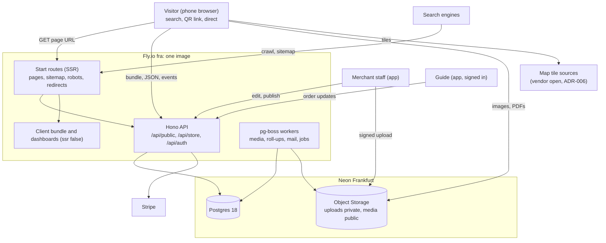
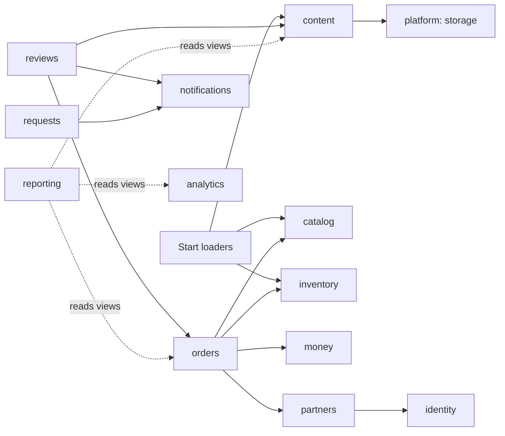
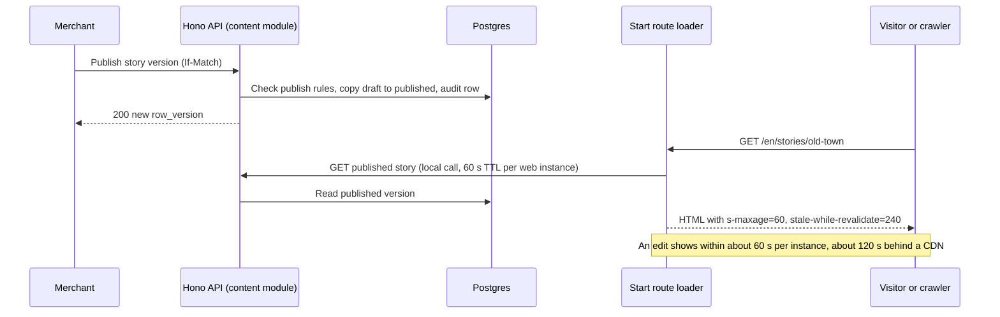

# Architecture: storytelling pivot

This spine fixes the decisions that separately built parts must share. It does not redesign the backend. `docs/architecture/backend.md` still governs payments, orders, partners, auth and operations, and this document says where PRD v3 changes it. Thirteen major decisions are recorded as ADRs in `docs/adr/` (ADR-001 to ADR-012 and ADR-021, all `accepted`). ADR-013 to ADR-020 belong to the data model. Nothing is built yet (owner, Q2), so the spine also gives an order of work from today's prototype. Owner gates S1, S1b, S2 and S3 (2026-10-26) fixed the framework, the editor and the commerce approach, after spikes.

Status is `accepted`. The owner approved the design on 2026-10-26 (gates DESIGN and D8), and the ADRs moved to `accepted` with it.

Amended 2026-10-27 (gate G11, `docs/decisions/2026-10-27-map-pins-and-events.md`): places become pins that stand without a story, have no page and take no guest reviews; the map filters by merchant-edited categories; the base map style is settled. AD-6, AD-7, AD-9, AD-12, the route list, the capability map, the risks and decision D4 follow it. ADR-029 and ADR-030 record the new decisions.

## Goals and constraints

The product is a free, phone-first site that tells stories about Lucerne, ties each story to a pin on an interactive map, and offers Victorinox knives as a light add-on (PRD §1). Four facts shape the architecture.

1. Search engines must index each story page in each language (AC61, SM-1). Today the SPA uses hash URLs and an empty `index.html`. TanStack Start renders those pages on the server (owner gates S1 and S1b).
2. The merchant edits content at any time without a release, and visitors see it within about 60 seconds, at most 5 minutes (AC45, AC51, O39, owner gate D5).
3. Onboarding answers never leave the browser except as anonymous event values (Q12, G4).
4. Tour booking is hidden, not deleted, and the tour page shows no price (Q4, Q24, AC50).

Standing context used: `AGENTS.md`, `docs/development-rules/tech-stack.md`, `docs/architecture/backend.md` (proposal, D1 to D20), `docs/adr/` did not exist before this run, so no accepted ADR constrains it.

## Architecture style

The system stays one deployable TypeScript service on Fly.io plus Neon Postgres and object storage (backend.md D1 to D3, D14). The front-end becomes a TanStack Start app on Vite with a Nitro Node server (ADR-001). The Hono API runs beside it as a second process in the same Fly app and image, and the web server forwards `/api` and `/webhooks` to it (owner gate H1). Business code follows the four layers of backend.md section 4.1. PRD v3 adds three things on top of it.

- **Server-rendered public routes** (`front-end/src/routes/$lang/**`). Their loaders call module `index.ts` queries in the same process and render the page text, head tags, the sitemap and redirects. They hold no business rule. Dashboard routes are `ssr: false`.
- **Pure content rules** in `packages/domain/src/content/`: the language and slug resolver, the ranking function, and the outbound-link renderer. The routes and the dashboards both import them.
- **Browser-held personalisation.** The server only sees public tags and anonymous event values.



Dependency direction between modules follows backend.md: a module calls another only through that module's `index.ts`, inside one transaction when the change must be atomic.



`reporting` reads only SQL views, as in backend.md section 4.

## Invariants and rules

Each decision has a stable id. The ADR holds the options, costs and what would make the decision wrong.

### AD-1 Modular monolith and four layers stay [ADOPTED]

- **Binds:** all modules and the SPA's data access.
- **Prevents:** a second service or framework growing beside the API for content.
- **Rule:** Keep backend.md D1, D3, D9, D11 and sections 4.1 to 4.3 as written. Content, reviews, inventory and analytics are modules in the same service. The one-service rule holds until backend.md D1 says otherwise. The Start web server and the Hono API are two processes of one Fly app, from one image, behind one origin (ADR-001, owner gate H1).
- **Why:** The pivot changes what the service serves, not how many deployables the team can run. The delivery plan assumes one developer.
- **Alternatives rejected:** A separate content service or CMS (a second thing to run and a second database for joins that need one). A second server beside the API for rendering.
- **ADR:** none. This ratifies backend.md D1 to D3 and section 4.

### AD-2 Indexable pages are server-rendered by TanStack Start routes, and dashboards stay client-rendered

- **Binds:** AC24, AC30, AC61, SM-1, PRD §4.1, O21(a), owner gates S1, S1b, D5, D7, D10.
- **Prevents:** hash routes, a client-only public page, a second renderer for the same text, a dashboard route that renders on the server, and secrets in URLs that logs keep.
- **Rule:** The app is TanStack Start on Vite with browser history. Public content routes (`/:lang`, stories, map, tours, gifts, and their lists) render on the server with their head tags, hreflang alternates and the sitemap. `store/*`, `admin`, `partner/*`, `lab/*`, account, cart, sign-in and invitation are `ssr: false` with `noindex`. Loaders redirect with `statusCode: 302`. `/` redirects to `/:lang`, and every `/:lang` home and list page exists. Content reads use a 60-second TTL per web instance and `Cache-Control: public, s-maxage=60, stale-while-revalidate=240`, with no publish broadcast. The server is the Nitro Node target on Fly. The Hono API runs as a second process, and the web server forwards `/api` and `/webhooks` to it with cookies, `Origin`, the raw body and `Fly-Client-IP` intact (owner gate H1). Loaders read the API over the local network with the generated client, and the web server caches those reads for 60 seconds. CSS loads by side-effect import in `__root.tsx`. Server-only code loads by dynamic import. CI runs `tsc --noEmit`. Start and Nitro versions are pinned. The invitation token stays in the fragment, and the partner report token stays a path segment with `Referrer-Policy: no-referrer`, `noindex` and log scrubbing (owner gate D7). No page text, meta tag, JSON-LD, list or public list response carries a price (owner gate D10). The SPA loads price and availability from the product detail route. Guest review text is not in the server text. `/r/:code` accepts a same-origin target path (AC24). A hash-link shim maps old `#/path` links.
- **Why:** The owner chose one framework after two spikes. Start kept the router and the 89 route files, passed every spike question, and sent about 15 percent less first-load JavaScript than Next.js.
- **Alternatives rejected:** API-built HTML with a client takeover (a second renderer, a parity test). Next.js (a rewrite of the route files, 307 redirects, a cache handler for several instances). Next.js for the public site beside the SPA (two frameworks). Build-time prerender or a prerender service.
- **ADR:** `docs/adr/ADR-001-indexable-pages-with-tanstack-start.md`

### AD-3 A page is a translation group, and the URL decides the page language

- **Binds:** AC30, AC61, AC64, R02, PRD §4.1, Q22, O01.
- **Prevents:** two builders choosing a different slug scope, a different missing-language behaviour, or a router that lets the stored language override the URL.
- **Rule:** URLs are `/:lang/:type/:slug` with `lang` in `en` or `de`. A slug is unique per type and language across the platform. A version exists only if published with its required fields. A missing-language address redirects with 302 to the version that exists, or returns 404. The SPA shows the "only in another language" notice when the stored preference has no version. Only the switcher writes the stored preference. `/` and unprefixed URLs redirect to the language cookie `sk_lang` (written only by the switcher), else `de` when `Accept-Language` asks for German, else `en`. English is the default and `x-default` is English (owner gate D6, 2026-10-26). One public site uses platform-wide slugs (orchestrator ruling). One resolver in `packages/domain/src/content/` serves router, sitemap, hreflang and switcher.
- **Why:** It satisfies AC61 (no duplicate text at an address) and AC64 (a notice, not a mix) with one rule.
- **Alternatives rejected:** Stored preference wins over the URL (same URL shows two texts). Query parameter or subdomain (duplicate-looking URLs, or DNS and a second origin).
- **ADR:** `docs/adr/ADR-002-page-identity-and-languages.md`

### AD-4 Authoring is the in-app merchant editor over Postgres, with draft and publish

- **Binds:** AC16, AC31, AC45, AC51, AC68, AC85, PRD §4.1, §11, O21(b), O39.
- **Prevents:** content stored in repository files or a second system, or a publish that bypasses the editor's rules.
- **Rule:** Merchant staff author through the app. The `content` module stores draft and published content, uses `row_version` with `If-Match`, and writes `audit_log` rows on publish. Visitors read only published content. Structured blocks are the body format. Public JSON reads send `max-age=30`, server-rendered pages use a 60-second TTL, so the expected delay is about 30 to 60 seconds. The owner set O39 to about 60 seconds typical and a 5-minute cap (owner gate D5, 2026-10-26). The publish rules of AD-6 run in the use case, not only in the UI.
- **Why:** It reuses the existing editor, adds no vendor, and keeps pins next to stories and keepsake links.
- **Alternatives rejected:** Markdown files in the repository (an edit needs a deploy). Payload CMS (second Next.js deployable, pinned `drizzle-orm` and `pg`, integer ids, a locale per document and not a translation group, about 500 packages). Sanity (hosted, content leaves our database, USD 15 per seat a month). Strapi (a second server and admin users, paid SSO). The owner chose the own editor (gate S2).
- **ADR:** `docs/adr/ADR-003-content-authoring-and-publishing.md`

### AD-5 Uploads live in Neon Object Storage, published files under versioned public keys

- **Binds:** AC32, AC51, PRD §7.3, Q19, O21(d).
- **Prevents:** merchant uploads served from bundled assets, stale PDFs after a replace, or signed download links on a free PDF.
- **Rule:** Browsers upload to a private bucket by presigned PUT. The API or worker validates, makes variants, and copies to a `public_read` bucket under a versioned key. The database stores keys and metadata. Content references media by id. The `content` module owns media rows, and other modules (`catalog` for keepsake photos) reference them by id. Cleanup deletes a key only when no module references it. A tour has exactly one PDF reference covering all languages (owner gate D9, 2026-10-26), replaced in one transaction. `sharp` makes the image variants (owner gate D3, 2026-10-26).
- **Why:** The vendor and region are already planned (D14), and a versioned public key removes cache staleness and signing.
- **Alternatives rejected:** A private bucket with presigned GET (not shareable, not cacheable). Cloudflare R2 or S3 now (a second vendor, held as fallback). `bytea` in Postgres (database growth, API in every download).
- **ADR:** `docs/adr/ADR-004-media-and-pdf-storage.md`

### AD-6 Stories, pins and tour guides are aggregates of the `content` module

- **Binds:** AC31, AC42, AC50, AC67, AC68, AC85, AC86, PRD §7.3, §11.1 to §11.3, Q15, Q18, G9, G11 (overturns G8's four types).
- **Prevents:** a pin's main story pointing at a language version, route stops that create pins, a story forced on every pin, and prices or departures on a tour page.
- **Rule:** A story group has language versions. Related stories and keepsake links sit once on the group and are shared by both languages (owner gate M1). A link to a story with no version in the reader's language is hidden. A pin is a place or an event on the map. It belongs to a store, has no fixed type, and publishes on its own: a main story group and an outbound link are optional (G11). It carries map categories, optional weekly hours and optional date entries, and a pin whose last date has passed drops off the map. A tour guide has information, a route of stops (value objects with their own coordinates and an optional place reference), tags, linked keepsakes and exactly one PDF. It has no price, departure or seat. Stay tags are `short_stay`, `multi_day`, `both`. Interests are the four fixed codes. A pin is `draft`, `published` or `hidden`. A pin that was published is hidden, never deleted. Nothing protects a pin's main story: a story is unpublished or deleted under its own rules, and the pin card omits a story link with no published version. Pins have no page and no guest reviews. The pin model is ADR-029.
- **Why:** It matches the existing `Article` model and the seed routes. Once pages and reviews were dropped, a place and an event differ only in their dates, so one pin model serves both.
- **Alternatives rejected:** Route stops that reference pins (every seed stop would have to become a pin). A pin pointing at a version (breaks when one language is unpublished). A separate `places` module (cross-module transactions on every publish).
- **ADR:** `docs/adr/ADR-005-content-context-aggregates.md`

### AD-7 Onboarding and ranking stay in the browser, and the map loads pins as one cached list

- **Binds:** AC36 to AC39, AC41, AC42, AC44, AC87 to AC90, Q12, Q26, G3, G4, G11, PRD §3, §11.1, O23.
- **Prevents:** onboarding answers reaching a server route, personalised server output, and two ranking implementations.
- **Rule:** `localStorage` key `sk.onboarding` holds the answers. One function `rankItems` implements the PRD §3.2 order, and the Explore list and map both use it. API lists and server-rendered pages are not personalised and carry public tags. `GET /api/public/map` returns all published pins in one cached response, with their categories and next date, and omits a pin whose last date has passed. A pin detail loads on pin open (`GET /api/public/places/:id`). Category chips highlight the chosen category and dim the other pins, and a parent chip also covers pins tagged only with its sub-categories (AC88, ADR-030). `/:lang/map?place=<slug>` opens the map with that pin's card (AC90), or with the notice "This place is no longer on the map" when the pin is hidden, expired or unknown, and the card's directions button hands off to the phone's own map app (AC89, inside G9). A contract test fails if `segment` or `interests` appears on any route except the event route. MapLibre loads by dynamic import. The SPA never asks for the visitor's location (AC67). A skipped onboarding does not return on its own, and the visitor reopens it from the Account tab or the home (orchestrator ruling; amended 2026-10-28: a full-screen flow at the front door and a small prompt on deep links, guests only, ADR-006). The base map is settled (G11): MapLibre with swisstopo SWISSIMAGE photos and OpenFreeMap text layers, flat 2D with no tilt, and the AWS Terrarium source removed. The map and the tour route map share this one style, with the credits "© swisstopo" and OpenFreeMap, OpenMapTiles and OpenStreetMap. Re-reading the SWISSIMAGE terms before launch stays an assumption (ADR-006). Merchant-edited map categories are the filter chips (ADR-030).
- **Why:** It meets Q12 and G4 by construction and keeps server-rendered pages identical for every visitor and crawler.
- **Alternatives rejected:** A preference cookie read by the server. A server-held profile. Viewport queries or vector tiles for Phase 1 (not needed at this size).
- **ADR:** `docs/adr/ADR-006-browser-personalisation-and-map-data.md`

### AD-8 SM-1 to SM-3 events go to a first-party log with no persistent identifier

- **Binds:** AC37, AC60, SM-1 to SM-3, Q28, G4, PRD §13, O14.
- **Prevents:** segment data travelling with a GA4 client id, a referral `visitor_id` or an order id.
- **Rule:** `POST /api/public/events` accepts an allow-listed batch, is mounted before `authenticate`, never reads `Cookie`, and sets none. The browser sends it with `fetch`, `keepalive` and `credentials: 'omit'`. The allow-list is the six AC60 events plus `outbound_click`, lives in `packages/api-contract`, and grows only by a contract change. The session id is random and kept in memory, never stored. Events never carry account, order, referral or partner ids, an IP address or review text. Segment and interests go to this route only, and no third-party analytics tool is loaded. No view joins event rows to orders, identity or partners below aggregate counts. A worker job rolls events up for `reporting`. Search traffic comes from referrer class, and Search Console covers queries.
- **Why:** The merchant dashboard sits in our app, and G4 holds without relying on a vendor's setting. The owner chose this on 2026-10-26 (owner gate D2).
- **Alternatives rejected:** Plausible (paid plan for custom properties and funnels, dashboard outside our app) and GA4 (persistent client id). Both were rejected by the owner (gate D2). Retention period and the lawyer's consent check stay open.
- **ADR:** `docs/adr/ADR-007-anonymous-analytics-event-log.md`

### AD-9 One `reviews` module owns all guest-written content

- **Binds:** AC16, AC17, AC46, AC48, AC69, PRD §11.6, Q16, Q17, Q21, G7, G11, O25, O33.
- **Prevents:** two copies of the moderation rule and a delete path.
- **Rule:** Story comments and product ratings live in `reviews`. Places take no guest reviews (G11). Targets are ids, checked through `content/index.ts` and `orders/index.ts`. Insert is visible at once, merchants hide and unhide, nothing is deleted, and hide history is append-only. A per-account rate limit applies. Counts and averages use visible items only.
- **Why:** One moderation rule serves both kinds, and a single module is the one place to change it when the lawyer answers O33.
- **Alternatives rejected:** Reviews stay in `catalog` and `content`. Guest-written text as `content` rows.
- **ADR:** `docs/adr/ADR-008-reviews-module.md`

### AD-10 One `inventory` module owns SKU stock and holds

- **Binds:** AC05, AC52, AC53, AC55, AC65, AC66, PRD §6.2, §7.2, Q14, Q23, G1, G2.
- **Prevents:** the stock invariant split between two modules, and a cash order that waits for payment or times out.
- **Rule:** `catalog` owns the SKU definition (design, size, colour, price). `inventory` owns on-hand stock and holds, and exposes `reserve`, `release`, `issue`, `setOnHand` and `availability`. Auto-accept reserves in the order's creation transaction when stock and preparation time allow. A guide cash order goes to `preparing` at acceptance with no payment deadline. Deposit, pay-later and engraving are not built.
- **Why:** Available stock equals on hand minus held, and one owner can enforce that under one lock.
- **Alternatives rejected:** Stock in `catalog` and holds in `orders` (today's split, with a cross-module read). Stock and holds in `orders`.
- **ADR:** `docs/adr/ADR-009-inventory-module-for-sku-stock.md`

### AD-11 Guides write through signed-in partner accounts created by invitation, and report links stay read-only

- **Binds:** AC12, AC58, AC59, AC65, PRD §5, §10.4, Q9, G1, G6, O24, O34, O38.
- **Prevents:** guide writes through the 30-day report-link session, and a group entity (handovers replace it), and a handover rule written in two modules.
- **Rule:** The merchant invites the partner, who signs in through Better Auth and receives the partner role from the accepted invitation (owner gate D1, 2026-10-26). Self sign-up yields the guest role only, and no path grants a partner or staff role without an invitation. The `partners` module links the partner to the user id. The actor kind `partner` with a `guide` capability may write arrival, departure, pickup, delivery and cash fields only on orders whose `partner_id` is the guide's own. An actor holds several capabilities, because a guide is also a guest. One `orders` use case changes pickup and delivery time for staff and guides and reruns the auto-accept policy. Every write stores who, when and the previous value. The guide sees the guest's name and nothing else. Handovers follow the approved record `docs/decisions/2026-10-26-partner-handover.md` (owner gate G6). The `orders` module owns handovers and their dated occurrences, and an order on the partner path points at one occurrence and takes its `partner_id` from it. The handover tables sit in the `orders` schema (ADR-024). `catalog` keeps the pickup point list (M12), in `catalog.pickup_places`. `partners` keeps identity, referral visits, commission and guide accounts, and `orders` calls it to record commission at `Delivered`. No group entity exists.
- **Why:** A cash amount creates commission, so the writer needs a stable identity.
- **Alternatives rejected:** Writes through the report-link session. A per-visit token (replaced by handovers). Handovers owned by `partners` (needs a read of `orders` and makes a cycle with the commission call).
- **ADR:** `docs/adr/ADR-010-guide-write-access-through-accounts.md`

### AD-12 Outbound links live on the pin, rendered by one function

- **Binds:** AC63, PRD §11.5, Q30, O21(c), O33, O39, G11.
- **Prevents:** outbound URLs typed into stories, which a later affiliate switch would have to edit.
- **Rule:** Any pin has at most one outbound link, a plain URL. The server render and the browser render build the anchor through one function that sets `rel`. The affiliate kind, network and disclosure fields wait until the first paid link exists (O33). A hotel is a pin in a category such as "Stays" and has nothing else special. Content refers to the place by id. Click counts go through the event log. An `/out/:placeId` redirect is reserved, not built.
- **Why:** Adding paid links later is one renderer change and no content edit.
- **Alternatives rejected:** A redirect route from day one (extra request and trust cost, held in reserve). A link-wrapping service (new vendor, rewrites links we do not control).
- **ADR:** `docs/adr/ADR-011-outbound-link-by-place.md`

### AD-13 Tour booking is hidden by moving its routes and screens out of the build, and its rules stay compiled

- **Binds:** AC50, AC54, PRD §4.2, Q4, Q6, Q24.
- **Prevents:** a path to booking, a price on a tour page, and a booking backend built by accident.
- **Rule:** Move the booking route wrappers and the booking screens to `front-end/src/dormant/` (excluded from `tsc` and lint). Remove every entry point and link, including the `?book=true` sheet on the live tour page. Tour information renders from the tour guide type with no price or departure. The tour editor loses departure and price fields. Keep `packages/domain/src/bookings/**` compiled with its unit tests. Do not build the `bookings` module, its tables or routes.
- **Why:** The owner said "hide, keep the code". Removed routes leave no path, and the rules that carry the money logic stay compiled.
- **Alternatives rejected:** A flag that keeps routes registered (a path exists, partial unhiding, though the code never drifts). Deleting the code (owner ruled it out).
- **ADR:** `docs/adr/ADR-012-hide-booking-by-removing-routes.md`

### AD-14 No commerce engine: catalog, inventory, cart and orders are our own modules, with Stripe for payments

- **Binds:** PRD §6.2, §7, §8, §9, AC05, AC52, AC53, AC65, AC66, owner gate S3.
- **Prevents:** a commerce engine added beside the modules, and a second user system or admin for the shop.
- **Rule:** `catalog`, `inventory`, `orders` and `money` implement the shop and the order lifecycle (backend.md D6, D7, D18). The cart is a server cart in `orders.carts` and `cart_lines`, with the cart id in a cookie. Stock and price are re-checked on each change and at checkout, and one cart can complete into several orders (owner gate M7, data model ADR-026). Each order keeps the guest's name and e-mail (gate M8), and commission is recorded at completion, which is delivered and fully paid (gate C1, ADR-028). `catalog` models generic Medusa-style product options (ADR-027) and keeps category tables, with no category UI in Phase 1 (owner gates M9 and M10). Stripe takes payments through the Payment Element, and TWINT follows the account's settings (CHF, Switzerland only, no manual capture). The db-designer studies Medusa 2's open-source schema and commerce model as a reference for cart, order creation, products and variants, categories, inventory and purchasing policies, and the server cart, generic options and category tables are adopted from it. No Medusa code or package enters the repository.
- **Why:** The lifecycle has auto-accept, guide cash and commission that a standard checkout does not model, and customer data stays in our database.
- **Alternatives rejected:** Medusa 2 (a second backend with Redis, its own user system and admin). Shopify (customer data leaves the EU, USD pricing, checkout off our site). WooCommerce (WordPress, PHP and MySQL).
- **ADR:** `docs/adr/ADR-021-own-commerce-logic-with-stripe.md`

## Module map against backend.md section 4

| Module | Change for PRD v3 | Owns after the change |
|---|---|---|
| identity | Add the partner role from an accepted invitation (AD-11). No other change. | Stores, memberships, invitations, admins, guest profiles, Better Auth tables |
| catalog | Narrows to Victorinox. Keeps the pickup point list (M12), which handovers and orders reference by id. Tours move to `content`. Reviews move to `reviews`. Stock moves to `inventory`. The four fixed categories and merchant sub-categories go from the UI. Generic options and category tables stay in the data (gates M9, M10, replaces D17). | Designs, sizes, colours, SKU definitions, price, publication, pickup places |
| inventory (new) | AD-10 | Stock items, stock holds, adjustment history |
| orders | Auto-accept (G2), guide cash path (G1), handovers and their occurrences with the partner path statuses (G6, AD-11), a pickup time on every order, no deposit or pay-later, no engraving. Stock calls go through `inventory`. | Orders, order lines, pickup changes, handovers, handover occurrences |
| bookings | Not built (AD-13). Design stays in backend.md, marked dormant. | Nothing |
| money | Booking kinds and seat-hold rules are dormant. A guide cash method is added. | Payment attempts, ledger, exceptions, cost records |
| partners | Referral and commission unchanged, except that on the partner path the handover fixes the partner. Guide accounts (AD-11). Commission is recorded at `Delivered` when the order is fully paid, otherwise when payment completes (owner gate C1). | Partners, referral visits, report sessions, commission entries |
| content | Grows: story groups and versions, pins, map and blog categories, tour guides with routes and PDF reference, media, outbound links, publication. Comments move out. | See AD-6 |
| reviews (new) | AD-9 | Story comments, product ratings, moderation history |
| analytics (new) | AD-8. Ingest and roll-up only. | Event log, roll-ups |
| requests | Keeps the simple advice request form (G10). Private tour requests are dormant. | Advice question sets, advice requests |
| notifications | New template for a new review. Booking templates stay unbuilt. | Templates, sent mail |
| reporting | Adds SM-1 to SM-3, content and stock views. Reads roll-ups and views only. | Views |
| Public routes (Start loaders, not a module) | AD-2, AD-3 | Server-rendered pages, sitemap, robots, redirects |

## Consistency conventions

| Concern | Convention |
|---|---|
| Naming | Cookie `sk_lang` holds a language code only. Public URL slugs are lower-case letters, digits and single dashes. Event names are the snake_case names in AC60 plus `outbound_click`. Browser storage keys start with `sk.`. Module names are singular nouns for what they own. |
| Page identity | A translation group id ties language versions. hreflang, the switcher and main-story references use it. A version row or localized field set exists per language. |
| Data and formats | Ids are UUIDv7. Localized text is `{en?, de?}` for pins, tours and keepsakes. Story versions are rows. Publication states are `draft` and `published`. Interests and stay tags are constants in `packages/domain`. |
| Indexing | Only the server-rendered routes in ADR-001 are indexable. Every other app URL sends `noindex`. Staging and local builds send `noindex` and a disallow-all `robots.txt`, switched by one config value. |
| Caching | Server-rendered pages use a 60-second TTL per instance and `s-maxage=60, stale-while-revalidate=240`. Public JSON lists use `max-age=30`. Media and PDFs use immutable versioned keys. |
| State and cross-cutting | Commands keep `Idempotency-Key`, `If-Match` and RFC 9457 errors (D11). The event route is best-effort and takes no `Idempotency-Key`. Same-origin checks apply to it. Personalisation values never appear in a request outside the event route. |
| Embedded media | A video renders as a link or facade in the server text and loads the player only on click (AC32). Audio is a pre-recorded file. |

## Stack

These versions come from `front-end/package.json`, `api/package.json` and `docs/development-rules/tech-stack.md`. The code owns them once it exists.

| Name | Version |
|---|---|
| TypeScript | 5.9 |
| React with React Compiler | 19, Compiler 1.0 |
| TanStack Start | 1.169.4 (spike, pin exactly) |
| Nitro, Node target | 3.0.260903-beta (spike, pin exactly) |
| Vite | 8.3 |
| TanStack Router | 1.170 |
| TanStack Query | 5.104 |
| MapLibre GL | 6.14 |
| Tiptap | 3.32 |
| Hono | 4.13 |
| Neon Postgres | 18 |
| Drizzle ORM | 0.45 |
| pg-boss | 12.38 |
| Better Auth | 1.7.11 |
| Neon Object Storage (AWS Frankfurt) | no version, docs read 2026-10-26 |
| Playwright | 1.64 |

## Structural seed

URL scheme and server-rendered routes (ADR-001, ADR-002):

```text
/                          302 to /:lang (sk_lang cookie, Accept-Language de, else en)
/:lang                     home page
/:lang/stories             story list
/:lang/stories/:slug       story page
/:lang/map                 map page (title, description, links), the map loads in the browser; ?place=<slug> opens a pin card, not indexed separately
/:lang/tours               tour information list
/:lang/tours/:slug         tour guide page, PDF link
/:lang/gifts               Keepsakes list (path name unchanged, PRD §7.0)
/:lang/gifts/:slug         Keepsake page (price loaded by the SPA, not in the server text)
/r/:code                   records referral visit, 302 to a target path or /:lang
/sitemap.xml, /robots.txt  server routes
/store/*, /admin, /partner/*, /lab/*, /account, /cart, /sign-in, /invitation   ssr false, noindex
/api/public/map, /api/public/places/:id, /api/public/events   new public routes
```

Publish to visit (ADR-003, ADR-001):



Environments and operations (backend.md sections 11 and 13 stay):

- Local, staging and production use the three Neon branches and, for storage, the branch-aware buckets of Neon Object Storage. Only production sends indexable pages.
- Production runs two Fly machines in `ROLE=all` (D1), each running a `web` process (Nitro Node server) and an `api` process (Hono, `ROLE` as in D1), from one image. The web process forwards `/api` and `/webhooks` to the API process. No CDN sits in front in Phase 1. Pages use the 60-second TTL, media use immutable keys.
- Jobs added: media variants and cleanup of unreferenced objects, old-PDF removal after a grace period, event roll-up, and event retention.
- Checks added: an uptime probe on one server-rendered URL, `tsc --noEmit` in CI (the Start validator mismatch), a sitemap validity test, a log test that finds no report token, and Search Console for the production property.
- Source tree additions:

```text
front-end/src/routes/$lang/            server-rendered public routes, head tags, loaders
front-end/src/routes/sitemap[.]xml.ts  sitemap server route
api/src/platform/http/                 Hono app, its own process behind the web server (/api, /webhooks)
api/src/modules/{content,reviews,inventory,analytics}/
packages/domain/src/content/       resolver, ranking, link renderer, tour guide types
front-end/src/lib/analytics/       event sender, session id
front-end/src/dormant/routes/      booking route wrappers (excluded from tsc and lint)
front-end/src/start.ts             global request middleware (private-area headers; later CSRF). Owner gate G-E33-STARTMW, 2026-10-27.
```

## Migration from the prototype

The order matters. Each step names what it needs first. Phase numbers follow backend.md section 14, and the delivery plan gets re-cut by the owner after approval (Q3).

| Step | Work | Needs first | Exit check |
|---|---|---|---|
| 0 | Run SP5 (Neon storage: public URL, CORS, cache headers, presigned PUT). There is no SP9 spike (owner gate H1). | Nothing | SP5 written up in `docs/spikes/` |
| 1 | Hide booking (AD-13): move wrappers and screens, remove entry points and the `?book=true` sheet, split the `Tour` type into tour guide and booking rules, strip price and departures from tour info and the editor, skip the tour e2e flow. | Nothing. Can run in the prototype today. | `pnpm exec tsc --noEmit`, lint, tests green. No route or link to booking. AC50 and AC54 pass in demo mode. |
| 2 | Content on the API: story groups, places, tour guides, media tables, publish rules, merchant editors for pins, categories and routes. Move the content demo seed into a database seed. | Backend phase 2 (identity, catalogue reads, staging). Neon storage decision (SP5). | Staff publish a story and a pin, with and without a story, on staging. AC85 passes. No feature reads both sources. |
| 3 | Move the front-end to TanStack Start (ADR-001). Sub-steps and estimates in the table below. | Step 2 (content on the API) | AC61 passes on staging. A page loads with JavaScript off and is styled. Browser history works for every route. Invitation and Google sign-in flows pass their end-to-end tests. The `/partner/*` response sends no-referrer, and an access-log test finds no report token (owner gate D7). |
| 4 | Map and personalisation: the pins endpoint, `rankItems`, full-screen onboarding on a first visit at the home and a small prompt on deep links, for guests only, map screen on real data. | Step 2. The flat aerial style is settled (G11, ADR-006). | AC36 to AC38, AC42, AC44, AC86 to AC90 pass. |
| 5 | Orders core for keepsakes: order creation and lifecycle, external collections in `money`, partner attribution on the order (backend.md phase 3, reduced to Victorinox). | Step 2, backend identity (done) | A keepsake order completes on staging with an external payment. |
| 6 | Reviews module and sign-in-gated review flows. Move comments and product ratings. | Steps 2 and 5 (AC17 needs completed orders) | AC46, AC48, AC69, AC17 pass. |
| 7 | Inventory and SKU model, auto-accept and the guide cash path. | Step 5, O22, O26 | AC05, AC52, AC53, AC65, AC66 pass. |
| 8 | Analytics: event route, sender, roll-up, dashboard views. | Step 3 | AC60 passes for a week of staging traffic. |
| 9 | Guide accounts, handovers and their statuses (AD-11, the partner handover record). | Steps 5 and 7 | AC58 and AC59 pass. A handover is proposed, agreed, filled by the partner QR, received and delivered end to end on staging. |
| 10 | Stripe payments, refunds and partner commission as in backend.md phases 3 to 5, reduced to keepsakes. | As in backend.md | As in backend.md |

Step 3 in pieces (spike question 9, an estimate of about 2 to 3 weeks for one developer, not measured):

| Piece | Days | Notes |
|---|---|---|
| Check real app providers (session, demo store, locale) under server rendering, first (owner gate H1) | 1 | Moved here from the dropped SP9. Includes `vite dev` and client navigation between stories |
| Entry and router setup for Start and Nitro | 2 to 4 | The 194 router-importing files and the `search-params.ts` pattern stay |
| Hash history to browser history | 1 to 2 | Main risk: `#/` links (not redirected, G-E34-NOSHIM), `takeGoogleReturn` (remove), `captureInvitations` (keep, test), invitation tokens |
| Guard browser-only code on the server | 2 to 4 | 8 files use browser storage and 42 touch `window` or `document`. Dashboards stay `ssr: false` |
| Content routes with real server rendering | 1 to 2 for the first type | Stories first, then tours, gifts. Language-prefixed routes add no days |
| Deploy | 1 to 2 | Dockerfile, `fly.toml` with two processes (`web`, `api`), forwarding of `/api` and `/webhooks`, verify scripts |

Ordering rules:

- No server-rendered page ships before its content is served from the database. The demo store cannot feed server rendering.
- The demo stays on Vercel static hosting until launch. The Fly staging app hosts only the real app, and Vercel is retired at launch (owner gate H3, 2026-10-26, amending H2).
- The seed data keeps working during the move because each feature switches in full (backend.md section 14, last paragraph).

## Capability to architecture map

| Capability or area | Lives in | Governed by |
|---|---|---|
| Story pages, indexable (AC61) | Start routes, `content` | AD-2, AD-3 |
| Pins and the pin card (AC42, AC85, AC86) | `content`, SPA map | AD-6, AD-7 |
| Language rules (AC30, AC64) | `packages/domain/src/content/` resolver | AD-3 |
| Merchant editing and publish (AC45) | `content`, merchant editor | AD-4 |
| Tour PDF and media (AC32, AC51) | `content`, Neon Object Storage | AD-5 |
| Tour information, no booking (AC50, AC67) | `content`, SPA | AD-6, AD-13 |
| Onboarding and ranking (AC36 to AC39, AC41, AC44) | Browser, `rankItems` | AD-7 |
| Map data and categories (AC42, AC87 to AC90) | `content`, `/api/public/map` | AD-7, AD-6 |
| Analytics (AC37, AC60) | `analytics`, `reporting` | AD-8 |
| Comments and ratings (AC46, AC48, AC69) | `reviews` | AD-9 |
| SKU stock and variants (AC52, AC53, AC55) | `catalog`, `inventory` | AD-10 |
| Auto-accept and cash orders (AC65, AC66) | `orders`, `inventory`, `money` | AD-10 |
| Guide operations (AC58, AC59) | `partners`, `orders`, `money` | AD-11 |
| Outbound link and affiliate readiness (AC63) | `content`, link renderer | AD-12 |
| Hiding booking (AC50, AC54) | SPA routes, `tours` feature | AD-13 |
| Price first at the product page (AC52, AC54) | Product page, loaded by the SPA | AD-2, AD-13 |
| Shop logic and payments (AC05, AC52 to AC55, AC65, AC66) | `catalog`, `inventory`, `orders`, `money`, Stripe | AD-10, AD-14 |
| Referral and commission (AC11, AC13) | `partners`, `money` | backend.md, unchanged |

## Risks

| Risk | Effect | Mitigation |
|---|---|---|
| Nitro is a beta release and Start has no official SPA-to-Start guide | A build or deploy breaks on an upgrade, or the migration runs over its 2 to 3 weeks | Pin Start and Nitro exactly. `tsc` in CI. Keep the spike folder as a reference. |
| Real app providers (session, demo store, locale) are not safe on the server | Server render fails or leaks state | Guard browser-only code. Dashboards stay `ssr: false`. Test providers at the start of step 3. |
| Two instances serve different edits for up to 60 seconds, or 120 seconds behind a CDN | A visitor sees an old story briefly | Inside the 5-minute cap (gate D5). A publish broadcast is the next step if needed. |
| Neon Object Storage is newer than S3 and R2, implements a subset, can answer `503 SlowDown`, and has no documented undelete | Public URLs, CORS or cache headers fail SP5, or a deleted file is lost | SP5 first, including a delete test. Set cache headers at upload. R2 is the fallback (D14). |
| Object storage backup is not described by Neon's restore history | A deleted published image cannot be restored | Open question. Test restore behaviour in SP5. Keep originals in `uploads`. |
| Free map tiles have no SLA (swisstopo fair use, OpenFreeMap commercial use with attribution) | The main screen goes blank or breaks terms | The style is settled (G11): SWISSIMAGE and OpenFreeMap, flat, no Terrarium. Keep it in configuration. Show both credits. Re-read the SWISSIMAGE terms before launch (E9.4). |
| Merchant cannot manage a pin and route editor | Content stays thin (PRD §16) | Usability test of the editor before pilot content entry. A headless CMS stays an option (ADR-003). |
| Immediate guest reviews attract spam or abuse | Legal exposure (O33) and bad pages | Per-account rate limit, merchant hide, reviews outside the server-rendered text. Lawyer check before real reviews. |
| Guide cash counts at once and can lead to the guide's own commission (O34) | Fraud or disputes | Distinct ledger method, Owner adjustment, reconciliation list. Guides sign in by invitation (owner gate D1). The cash risk stays open (O34). |
| Staging gets indexed by mistake | Duplicate content and leaked drafts | One config value controls `noindex` and `robots.txt`. A test asserts staging sends both. |
| Booking screens drift while out of the build | Costly unhiding | The money and transition rules stay compiled and tested. Restore the screens and fix what drifted. |
| Event endpoint abuse or bots inflate SM numbers | Wrong metrics | Allow-list schema, rate limit, bot filter, roll-ups only for the dashboard. |
| A story page is slow to render on the server | Slow first byte on a long story | The 60-second TTL covers repeated reads. Measure at the start of step 3. |

## Deferred

- **Rich text inside paragraph blocks.** Today a paragraph is plain text. A block-level change does not affect the route contract. Decide with the editor work.
- **Structured data beyond basic JSON-LD and any review markup.** Rules for self-serving and user-written reviews need a separate check.
- **Server-side personalised first paint.** Not possible without a cookie or profile (ADR-006).
- **A CDN in front of the API.** Revisit when measured traffic or SP5 shows a need.
- **Map vector tiles or viewport queries.** Needed only above about a thousand pins.
- **Guest cancel on the partner path.** Open under O36 (see Open questions).
- **An `/out/:placeId` redirect.** Reserved by ADR-011.
- **Cancellation policy (O36), exclusive multi-day content (O37), AI agent on tour content (O19).** Not Phase 1.
- **Languages beyond English and German.** The resolver takes a list of languages, but nothing else is prepared.
- **Payments, refunds, commission math, Super Admin matrix.** Unchanged in backend.md (O06, O07, O08).
- **The calendar tool (PRD §13.1a).** `FullCalendar` is in use and stays. The PRD sends the tool choice to O21 and the architecture changes nothing.
- **The exact `analytics` event retention period.** Needs the owner and the lawyer (O14).

## Conflicts with backend.md

These are the places where this spine departs from `docs/architecture/backend.md`. The proposed diffs in `.factory/runs/20261025-storytelling-pivot/` carry them. Nothing in backend.md is edited by this run.

| Item | Departure | ADR |
|---|---|---|
| Section 4, content | `articles` as one row per language becomes story groups with versions. Places, tour guides, media and links are added. | ADR-005 |
| Section 4, catalog | Tours and reviews leave. Stock leaves. | ADR-005, ADR-008, ADR-009 |
| Section 4, orders | `stock_holds` and the stock lock SQL move to `inventory`. | ADR-009 |
| Section 4, new modules | `reviews`, `inventory`, `analytics`. `bookings` is not built. | ADR-008, ADR-009, ADR-007, ADR-012 |
| D1, D3 | One image and one origin stay. The Fly app runs two processes: the Nitro Node server of TanStack Start (`web`) and the Hono API (`api`, `ROLE` as before). The web server forwards `/api` and `/webhooks` (owner gate H1). The 15-minute seat hold timer rationale no longer applies. | ADR-001, ADR-012 |
| D7 | Deposit and balance as two PaymentIntents, and manual capture for seat holds, belong to booking and are dormant. Keepsake orders pay in full. | ADR-012, ADR-009 |
| D8 and section 9 | "Partners have no user rows" holds for report links. It changes for guides, who sign in by invitation only (owner gate D1). | ADR-010 |
| D13 | Plausible and GA4 are not used (owner gate D2). SM events use the first-party log. Sentry EU stays. | ADR-007 |
| D14 | Extended to PDFs, two buckets and versioned keys. `media` rows move from `catalog` to `content`. | ADR-004 |
| Section 9, partner report link | The report token is a path segment, not a fragment. `/partner/*` needs no-referrer, noindex and token scrubbing in logs under browser history (owner gate D7). | ADR-001 |
| D17 | The four fixed categories and sub-categories leave the UI. Generic product options and category tables stay in the data, with no category screen in Phase 1 (gates M9, M10). | ADR-005, ADR-021 |
| D20 | Streamdown is not needed in Phase 1, since the advice widget is a plain form. | none, noted |
| Section 6.3 | Seat availability and hold are dormant. | ADR-012 |
| Section 14 | Phases re-ordered: hide booking, content slice and the Start migration come first. | this document |
| D18 | Confirmed. No commerce engine, with new research. | ADR-021 |

## Owner answers recorded

The owner answered these on 2026-10-26. Each is applied in the decision named. All ADRs were accepted at the design gate on 2026-10-26.

| Gate | Answer | Applied in |
|---|---|---|
| D1 | Guide accounts by invitation only. The merchant invites a partner, who signs in through the existing Better Auth flow and gets the partner role from the accepted invitation. Self sign-up yields the guest role only. Report links stay read-only. | AD-11, ADR-010 |
| D2 | First-party anonymous event log. Plausible and GA4 rejected. Retention and the lawyer's consent check stay open. | AD-8, ADR-007 |
| D3 | `sharp` approved as a new dependency. | AD-5, ADR-004 |
| D4 | Production map tiles were decided later, tied to O23. Settled by G11 (2026-10-27): SWISSIMAGE photos with OpenFreeMap labels, flat 2D, Terrarium removed. | AD-7, ADR-006 |
| D5 | O39: about 60 seconds typical, 5-minute cap. | AD-4, ADR-003 |
| D6 | O01: English is the default, German when `Accept-Language` asks for German, `x-default` is English. | AD-3, ADR-002 |
| D7 | The partner report token stays in the path, with `Referrer-Policy: no-referrer` and token scrubbing in logs. | AD-2, ADR-001, migration step 3 |
| D9 | One PDF per tour covers all languages. | AD-5, ADR-004 |
| D10 | No price in search snippets, JSON-LD offers, list pages, list JSON or public list responses. Price only on the product page. | AD-2, ADR-001, ADR-006 |
| H1 | The Hono API and the web server run as two programs side by side in one Fly app, one image, two processes. The Start server forwards `/api` as the dev server does. No SP9 spike. The real-providers check moves to the start of the migration. | AD-1, AD-2, ADR-001, migration step 3 |
| H2, H3 | H2 moved the demo to a Fly staging app. Gate H3 amends it: the demo stays on Vercel static hosting until launch, Fly staging hosts only the real app, and Vercel is retired at launch. | ADR-001, migration |
| G6 | Answered by the approved record `docs/decisions/2026-10-26-partner-handover.md`: partner handovers agreed between partner and merchant, orders tied to a handover occurrence. Module ownership: `orders` owns handovers and occurrences. | AD-11, ADR-010, ADR-009 |
| S1, S1b | TanStack Start for the whole app, confirmed by a passing spike. If the spike had failed, the question would return to the owner. | AD-2, ADR-001, ADR-002 |
| S2 | Own editor. Extend the Tiptap editor in the HeroUI dashboard. Payload, Sanity and Strapi rejected. | AD-4, ADR-003 |
| M1 | Related stories and keepsake links sit once per story group and are shared by both languages. A link to a story missing in the reader's language is hidden. | AD-6, ADR-005 |
| M7 | Server cart: `orders.carts` and `cart_lines`, cart id in a cookie, re-check stock and price on change and at checkout, one cart into several orders. | AD-14, ADR-021 |
| M9, M10 | Generic Medusa-style options and category tables in the catalog, no category UI in Phase 1. | AD-14, ADR-021 |
| S3 | No commerce engine. Own logic plus Stripe. Study Medusa 2's open-source schema as a reference. | AD-14, ADR-021 |

Orchestrator rulings: a skipped onboarding does not return on its own and is reopened from the Account tab or the home (ADR-006). One public site with platform-wide slugs (ADR-002). Loader redirects use status 302, `/` goes to `/:lang` home pages that must exist, content uses a 60-second in-process TTL with `s-maxage=60, stale-while-revalidate=240` and no publish broadcast, Start runs on the Nitro Node target on Fly, and Nitro is beta (ADR-001, ADR-002).

## Open questions

These need the owner or a named person.

1. Re-read the SWISSIMAGE terms before launch (ADR-006). The tile choice itself is settled (G11).
2. Event retention period, and whether the `localStorage` preference, the `sk_lang` cookie and the in-memory-id event log need consent or only notice (O14, O32). A lawyer answers, for the EU and for Switzerland (ADR-007).
3. Whether a guest can cancel an order on the partner path stays open under O36 (G5 removed the cutoff). The owner settled the other handover edge rules in the PRD: an unanswered proposal (AC77) and a cancelled handover, where guests choose self-collect or a full refund and the order keeps its partner (AC78). Cash the partner holds (O34) is out of scope for now (ADR-010).
4. Colour and size lists for SKUs (O26), and the preparation time that lets auto-accept run (O22).
5. Does Neon Object Storage restore deleted objects? Not found in the documentation read for this run. SP5 tests it.
6. O39(c): the level of disclosure for affiliate links.

## Traceability

| Requirement | Where it is settled |
|---|---|
| O21(a) address for search engines (Q5), gates S1 and S1b | AD-2, ADR-001, ADR-002 |
| O21(b) authoring tool (Q7), gate S2 | AD-4, ADR-003 |
| O21(c) affiliate-ready link model (Q30), deferred to the first paid link | AD-12, ADR-011 |
| O21(d) PDF storage (Q19) | AD-5, ADR-004 |
| AC61 own address per language, full text, no noindex, in sitemap | AD-2, AD-3, ADR-001, ADR-002 |
| AC45 edit shows without a release | AD-4, ADR-003 |
| AC51 PDF replace shows within the delay, one PDF per tour | AD-5, AD-6, ADR-004 |
| O39(a) maximum delay | AD-4, ADR-003 (owner gate D5) |
| O39(b) price in search results | AD-2, ADR-001 (owner gate D10) |
| O39(c) disclosure level | Open question 6 |
| Calendar tool (PRD §13.1a) | Deferred, FullCalendar stays |
| AC63 swap destination without content edits | AD-12, ADR-011 |
| AC68, AC85, AC86 pin rules (AC62 and AC68 rewritten, AC43 retired) | AD-6, ADR-005, ADR-029 |
| AC64 missing language notice | AD-3, ADR-002 |
| AC36 to AC38, AC44 onboarding and ranking | AD-7, ADR-006 |
| AC87 to AC90 categories, directions, `?place=` link | AD-7, ADR-006, ADR-030 |
| AC60, G4 events | AD-8, ADR-007 |
| AC46, AC48, AC69 story comments and product ratings (place reviews retired) | AD-9, ADR-008 |
| AC05, AC52, AC53, AC55, AC65, AC66 stock and cash path | AD-10, ADR-009 |
| AC58, AC59 guide operations | AD-11, ADR-010 |
| AC50, AC54, AC67 no booking, no price, no routing tool | AD-13, ADR-012, AD-6 |
| Onboarding in browser only (Q12) | AD-7, ADR-006 |
| Gate S3 commerce engine | AD-14, ADR-021 |
| Migration from prototype | Migration from the prototype |
