# Data model diagrams

Review page: https://claude.ai/artifact/Mx8Gtciom3aruvgEyYyWFr (private; source review.html in this folder).

These diagrams show the 48 new tables of the storytelling pivot. The `.mmd` sources were first generated from the tested DDL (`.factory/runs/20261025-storytelling-pivot/data-model-checks/ddl.sql`). Since gate G11 (2026-10-27) the `content` and `reviews` sources are edited by hand to match section 4 of `../data-model.md`, and the `.svg` files and `review.html` are not regenerated yet (see Regenerate). Each module has a Mermaid source (`.mmd`) and a rendered image (`.svg`). Open an SVG in a browser to zoom.

How to read them:

- A solid line is a foreign key inside one schema. There are 54, and every one is drawn.
- A dotted line is a plain id that points at another module (ADR-013). The database holds no key there, so the line is drawn from the column name, the DDL comments and the ER diagram in `data-model.md` section 2.
- Boxes marked "(stub)" show only the `id` of a table from another module or from `identity`. They are not new tables.
- Every table also has a `store_id`. It is a plain id to `identity.stores`, written in the column note and not drawn as a line.
- `PK`, `FK` and `UK` mark primary, foreign and unique columns. A note such as "unique with x, y" means the unique key covers several columns. A key that exists only so that another table can point at it, such as `(store_id, id)`, is not marked.
- `media_refs.owner_id` and the `content_id` columns of `analytics` point at one of several tables chosen by another column. They have no line.

## Overview

All 48 tables with no columns. Colour shows the schema, and the table names carry the schema prefix. Dotted lines are the plain ids between modules, except those to `identity`, which the module diagrams show.

## content

Stories, pins, tour guides and media. A story is a group with one version per language (`en`, `de`). The keepsake links, the related stories and the blog categories belong to the story group, so both languages share them. A place is a pin on the map. It has no type, an optional address and weekly hours, optional dates, map categories, one optional main story and one optional plain outbound link. A tour has a route of stops and one PDF. `media_refs` records which media a document uses, because a key cannot point into a JSON document.

The rules that matter:

- A pin publishes with or without a story (G11). A place changes from `draft` only once, and its first publish time is fixed.
- A published or hidden place and a published story version cannot be deleted. Hide it instead.
- A pin with dates is public only until its last date ends, in Europe/Zurich. The view `content.public_pins` holds that rule.
- Map and blog categories have one level. A category with children or links cannot be deleted.
- Published rows need their slug, name and coordinates, and a slug is unique per language.
- A media row cannot be retired while a column or document still uses it. A cover or PDF key also checks the media kind.

## catalog

Keepsake products and their generic options. A product has its own options (`product_options`, such as size or colour) with values (`product_option_values`). A SKU picks one value per option through `sku_option_values`, and exists only for a combination that is sold. The product also has a category tree (`product_categories`, linked by `product_category_links`), photos and pickup places with opening hours. Prices are whole Rappen and must be above zero.

The rules that matter:

- A SKU has one stored `combination_key`, unique within its product. A product with no options has one SKU. Triggers at commit keep the key and the option choices complete.
- A value must belong to an option of the same product, which the composite keys prove.
- A category cannot become its own ancestor. A trigger refuses a cycle.

The pickup places serve both self-collect orders and handovers. Opening hours are times of day in Zurich, and a span over midnight is two rows.

## inventory

Stock per SKU. `stock_items` holds `on_hand` and `held`. `stock_holds` is the source of truth, with one hold per order line, and a trigger keeps the two counters in step.

The rules that matter:

- Stock never goes negative. CHECKs require `held <= on_hand`, so available stock cannot drop below zero whatever the application does.
- `held` can change only through the hold trigger, and a direct write is refused.
- Issuing a hold lowers `on_hand` and writes an `issue` row to `stock_adjustments`. Adjustments and holds are never updated or deleted by hand.

## reviews

Story comments, product ratings and one moderation history over both. Guests do not review places (G11). A comment can have replies one level deep, and a reply stays under a comment of the same story. A product rating is one per guest, order and product.

The rules that matter:

- Nothing is deleted. A moderator hides or unhides through a `moderation_events` row, each naming exactly one target, a comment or a rating.
- A trigger on that row sets the visible state of the target, and a direct change of `state` is refused.

## partners

Partners (guides, hotels, others), their invitations and the accounts that sign in. A user becomes a partner only through an accepted invitation, so a self sign-up cannot become one.

The rules that matter:

- An account needs an invitation of the same partner that is accepted, not revoked and not expired, checked by a trigger at insert.
- A partner has at most one open invitation, and an accepted invitation stays accepted.
- An account is never deleted, its user never changes, and access ends through `revoked_at`.

## orders

Carts, orders and their lines, plus handovers: the agreement that a partner meets the shop's staff at a pickup place. A cart holds lines before checkout. Its id lives in a cookie, an anonymous cart has no guest, and a guest or partner can be set once. A cart line holds no stock. Completing a cart makes one or more orders, split by destination. A handover has dated meetings (`handover_occurrences`) and proposals for times. At a meeting the partner ticks received orders on a receipt.

The rules that matter:

- An order binds only to a meeting of its own partner. A composite key proves the match, and a CHECK requires a partner whenever an order is bound.
- At commit a trigger checks that the meeting is scheduled, its handover is agreed and its order cut-off is still ahead.
- A cart of a completed order carries the same guest as the order, and a completed cart must have an order. A completed cart accepts no line changes. The same SKU sits in two cart lines only when the destination or payment route differs.
- Order lines are written once. The order total is a price snapshot, and two deferred triggers check that it equals the sum of the lines.
- The partner, guest and total of an order never change.
- A one-off handover has exactly one meeting, and a handover has at most one open proposal, and one per meeting.
- Receipts are append-only. A ticked item moves its order to With partner in the same statement.

## analytics

An anonymous event log and two daily roll-ups. The event table holds no account, order, partner, visitor, IP, user agent, URL or exact time. Time is kept to the hour, and a session id with a sequence number is the key. A CHECK ties each event name to the content it may carry. The roll-ups count events and sessions per day. `record_order_submit()` adds to the funnel counters without storing the order. These tables have no relationship to any other table, by design.

## Regenerate

The `.mmd` files and the checks come from scripts kept in `.factory/runs/20261025-storytelling-pivot/diagram-tools/`. `render.sh` there turns every `.mmd` into an SVG with `@mermaid-js/mermaid-cli`, which is installed only in that folder. After G11 the `.svg` files and `review.html` in this folder still show 44 tables with place reviews and the typed place. Run `render.sh` to refresh the SVGs. `review.html` and the review page it was published as need a separate update.
